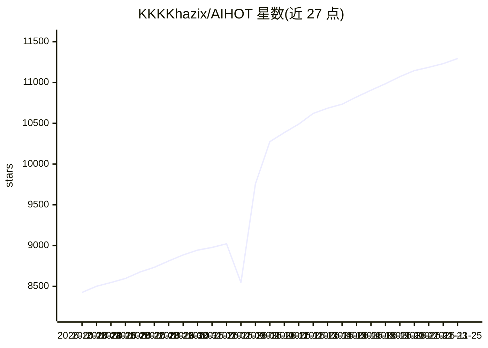

# KKKKhazix/AIHOT

⭐ 11,295 · TypeScript · MIT · 推送 2026-11-23 · [GitHub](https://github.com/KKKKhazix/AIHOT) · [官网](https://aihot.news) · 个人维护 · 中文 README

**自托管行业热点日报框架：AI 筛选、聚簇并自动成刊**

开源的新闻热点网站框架：从 RSS、网页列表、X、微信公众号等六种信源采集资料，用大模型预筛、独立打两次分，生成中文标题摘要，按向量与模型判断把多来源报道聚成事件并计算热度，定时输出日报、周报、月报。所有提示词与入选门槛公开可改，配套后台管理、SelectBench 校准脚本、MCP/RSS/API 等 Agent 接入出口。部署依赖 Docker Compose、Node.js 24 与一个 OpenAI 兼容的模型 API Key，仓库不含原站信源名单与运营数据。

## 筛选速览

| 维度 | 判定 | 备注 |
|---|---|---|
| AI 角色 | `ai-native` | 本体是模型或模型工具 |
| 许可风险 | `permissive` | MIT |
| 部署形态 | `self-host` | docker 或自建部署 |
| 模型依赖 | — | README 未给出锁定关系 |
| 硬件要求 | — | 无带数字的原话,不猜 |
| 安装摩擦 | `low` | 无编译、无系统依赖或容器化 |
| 成熟度 | `idea` | |

## 能力要点

- 六种信源接入与三级信源分级门槛
- 预筛加独立两次评分，提示词全部公开可改
- 多来源报道聚簇成事件，按独立来源数计算热度
- 对外提供 MCP、RSS、公开 API 与 llms.txt

## 适用场景

- 给法律、HR、金融等行业搭一个自动日报站
- 用自己标注的样本校准入选标准
- 把精选内容通过 MCP 或 API 接入自己的 Agent

## 场景标签

`工作流自动化` · 领域:效率与自动化

## 证据(README 行号)

> L22: AIHOT 是我做的一个 AI 热点网站。它每天从一批信源里收资料，用大模型先筛一遍、再独立打两次分，挑出真正值得看的，写成中文标题和摘要；把不同来源说的同一件事聚成一个事件，按有多少人在说排出热点；每天早上出一份日报。
> L24: 这个仓库是它的引擎和框架：网站、后台、精选流程、聚簇和热度算法，**所有提示词的原文和入选门槛**，都在这里。

## 星数曲线

2026-10-23 8,425 → 2026-11-25 11,295（+2,870）

---
*卡片 v1 · prompt 1.4 · 生成 2026-11-23 · 置信度 high · 依据 README sha `ed8c81df5217` · [字段定义](../../DATASET.md)*
