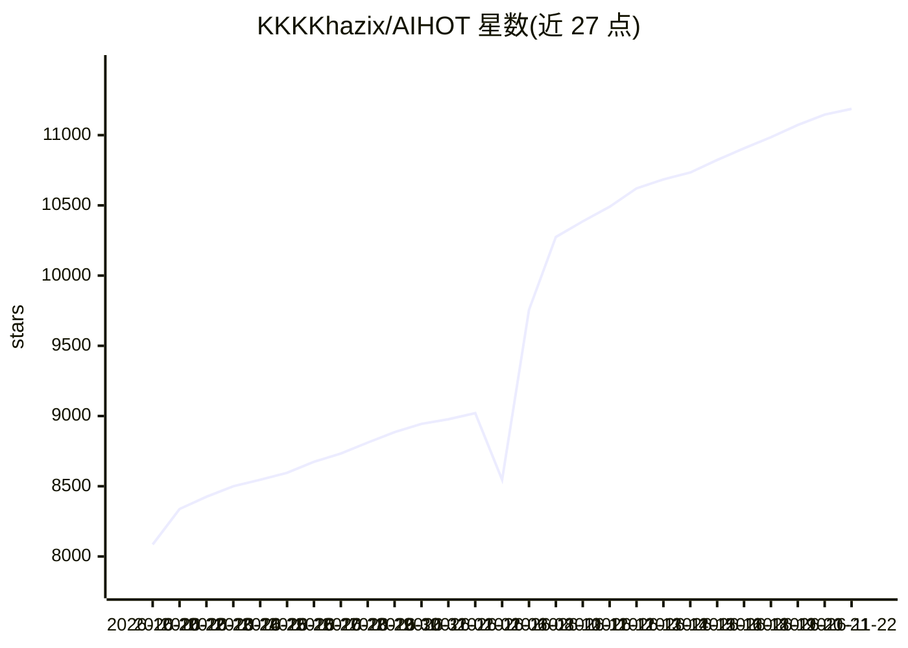

# KKKKhazix/AIHOT

⭐ 11,187 · TypeScript · MIT · 推送 2026-11-21 · [GitHub](https://github.com/KKKKhazix/AIHOT) · [官网](https://aihot.news) · 个人维护 · 中文 README

**自托管行业热点日报站框架：LLM 筛选聚簇成刊**

自托管的热点资讯站框架，六步流程：采集、预筛、独立两次评分、中文写作、事件聚簇、按独立来源数计算热度并编出日报周报月报。支持 RSS、网页列表、JSON 接口、X 账号、微信公众号、脚本推送六种信源，提示词与入选门槛全部公开可改。通过 Docker Compose 部署，需要 Node.js 24、PostgreSQL 与任一 OpenAI 兼容模型 API Key。面向想把信源与精选标准换成自己行业的运营者。

## 筛选速览

| 维度 | 判定 | 备注 |
|---|---|---|
| AI 角色 | `ai-native` | 本体是模型或模型工具 |
| 许可风险 | `permissive` | MIT |
| 部署形态 | `self-host` | docker 或自建部署 |
| 模型依赖 | locked-api |  |
| 硬件要求 | — | 无带数字的原话,不猜 |
| 安装摩擦 | `low` | 无编译、无系统依赖或容器化 |
| 成熟度 | `idea` | |

## 能力要点

- 六种信源接入与三级信源分级门槛
- 同一标准独立打两次分的精选流程，提示词与门槛全部可改
- 标题摘要向量聚簇成事件，按 48 小时独立来源数计算热度
- 对外提供 RSS、公开 API、MCP 与 llms.txt 供 Agent 读取

## 适用场景

- 给自己关注的行业搭一个每日热点日报站
- 把多个来源重复报道的资讯聚合成事件时间线
- 用自己的标注样本校准 LLM 精选标准
- 通过 MCP/RSS 接口把精选内容供给 Agent 使用

## 场景标签

 · 领域:内容聚合/资讯媒体

## 证据(README 行号)

> L22: AIHOT 是我做的一个 AI 热点网站。它每天从一批信源里收资料，用大模型先筛一遍、再独立打两次分，挑出真正值得看的，写成中文标题和摘要；把不同来源说的同一件事聚成一个事件，按有多少人在说排出热点；每天早上出一份日报。
> L9:  一个自己找热点、自己写日报的网站框架。
> L86: 需要 Docker、Node.js 24（运行 `init-env` 生成配置要用），和一个 OpenAI 兼容的模型 API Key（DeepSeek、千问、智谱都可以）。

## 星数曲线

2026-10-20 8,085 → 2026-11-22 11,187（+3,102）

---
*卡片 v1 · prompt 1.4 · 生成 2026-11-22 · 置信度 high · 依据 README sha `bcf039737867` · [字段定义](../../DATASET.md)*
