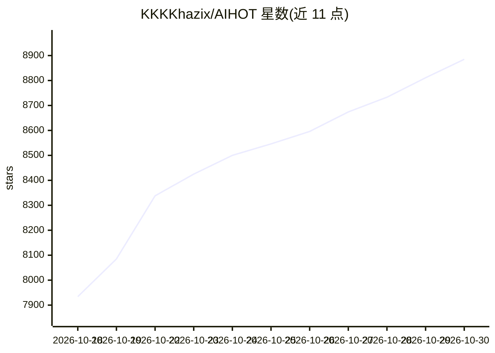

# KKKKhazix/AIHOT

⭐ 8,885 · TypeScript · MIT · 推送 2026-10-29 · [GitHub](https://github.com/KKKKhazix/AIHOT) · [官网](https://aihot.news) · 个人维护 · 中文 README

**自托管 AI 行业热点站框架：自动采集、精选、写日报**

一个用 Docker Compose 部署的网站框架：从 RSS、网页、JSON 接口、X 账号、微信公众号等六种信源采集资料，经大模型预筛、同一标准独立两次评分、写成中文标题与摘要，把多来源报道聚成事件并按独立来源数计算热度，定时生成日报、周报、月报。用户替换 industry/ 目录下的信源、提示词与门槛，即可改造成法律、人力资源、金融等行业的自有热点站。附 18 个示范信源，不含原站信源名单；需 Node.js 24、PostgreSQL 17 与 OpenAI 兼容模型 API Key（DeepSeek/千问/智谱等）。

## 筛选速览

| 维度 | 判定 | 备注 |
|---|---|---|
| AI 角色 | `ai-native` | 本体是模型或模型工具 |
| 许可风险 | `permissive` | MIT |
| 部署形态 | `self-host` | docker 或自建部署 |
| 模型依赖 | — | README 未给出锁定关系 |
| 硬件要求 | — | 无带数字的原话,不猜 |
| 安装摩擦 | `low` | 无编译、无系统依赖或容器化 |
| 成熟度 | `idea` | |

## 能力要点

- 六步流程：采集、预筛、两次评分、写作、聚簇、热点与成刊，所有提示词与入选门槛公开可改
- 按事件算热度：48 小时内独立来源只计一次，聚簇支持向量匹配与模型复核
- 同份内容同时给人与 Agent 用：RSS、公开 API、MCP、Agent Markdown、llms.txt
- 后台支持信源试抓、精选评测、每步单独换模型、付费服务预算熔断

## 适用场景

- 把信源和精选标准换成我的行业，搭自己的热点站
- 每天自动收到一份按门槛精选的行业日报
- 用自标注样本校准评分标准，控制入选质量

## 场景标签

`工作流自动化` `AI 写作` · 领域:效率与自动化

## 证据(README 行号)

> L22: AIHOT 是我做的一个 AI 热点网站。它每天从一批信源里收资料，用大模型先筛一遍、再独立打两次分，挑出真正值得看的，写成中文标题和摘要；把不同来源说的同一件事聚成一个事件，按有多少人在说排出热点；每天早上出一份日报。
> L47: 一条资料从信源进来，先判重，再预筛；可能重要的独立打两次分，写好中文标题和摘要，和别的报道聚成事件，算进热度。X 帖子没有正文或只有链接时，保留原帖的链接和图片，不调用写作或翻译模型。分数过了门槛、又不是精选里已有新闻的重复，才进

## 星数曲线

2026-10-18 7,934 → 2026-10-30 8,885（+951）

---
*卡片 v1 · prompt 1.4 · 生成 2026-10-20 · 置信度 high · 依据 README sha `63b4dd323779` · [字段定义](../../DATASET.md)*
