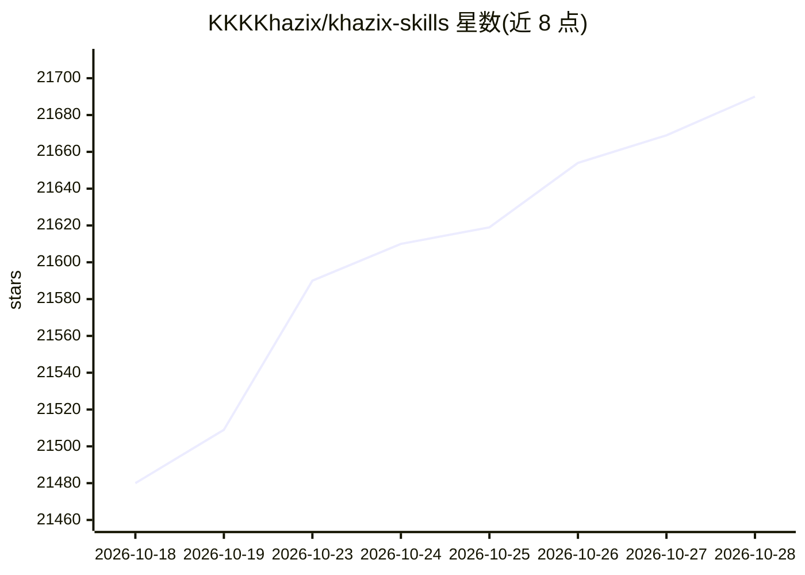

# KKKKhazix/khazix-skills

⭐ 21,690 · Python · MIT · 推送 2026-10-01 · [GitHub](https://github.com/KKKKhazix/khazix-skills) · 个人维护 · 中文 README

**个人开源的 Agent Skills 合集，给 Claude Code 等 40+ Agent 装载使用**

由数字生命卡兹克维护的 Agent Skills 仓库，含 6 个遵循 Agent Skills 开放标准的结构化指令集：leader（目标定义）、storage-analyzer（磁盘清理）、aihot（AI 资讯查询）、neat-freak（项目文档/记忆对齐）、hv-analysis（横纵分析法研究报告）、khazix-writer（公众号风格写作）。安装方式为在支持 Agent Skills 的工具中让 Agent 自行 clone 指定目录；不支持该标准的 Agent 可直接下载 SKILL.md 全文作为规则文件使用。MIT 许可。

## 筛选速览

| 维度 | 判定 | 备注 |
|---|---|---|
| AI 角色 | `ai-native` | 本体是模型或模型工具 |
| 许可风险 | `permissive` | MIT |
| 部署形态 | `None` |  |
| 模型依赖 | — | README 未给出锁定关系 |
| 硬件要求 | — | 无带数字的原话,不猜 |
| 安装摩擦 | `low` | 无编译、无系统依赖或容器化 |
| 成熟度 | — | 结构信号不足 |

## 动量与使用信号

- 维护:`active` — 距上次 push 16.8 天,年发版 0,1 位贡献者
- 涨星:近 1 天 **+39**(自 20261016 起算)
- 平台:WINDOWS / MACOS · 协议:MCP

## 能力要点

- 6 个遵循 Agent Skills 开放标准的 SKILL.md 指令集
- 支持 Claude Code、Codex、Cursor、Kimi Code 等 40+ 兼容 Agent 加载
- storage-analyzer 提供只读扫描与浏览器端三色分级删除确认
- 不支持该标准的 Agent 可下载 SKILL.md 作为项目规则文件

## 适用场景

- 给 AI Agent 定义长程目标并让其独立执行
- 扫描并分级清理 Mac/Windows 磁盘空间
- 生成产品/公司/概念的横纵向研究 PDF 报告
- 按特定公众号写作风格生成长文

## 场景标签

`提示工程` `AI 写作` · 领域:Agent 开发

## 证据(README 行号)

> L17: 这里的每个 Skill 都是 Agent 能直接加载的结构化指令集，遵循 Agent Skills 开放标准。Claude Code、Codex、Qoder、Kimi Code、iFlow、CodeBuddy、Cursor 等 4
> L5: #### 我自己每天在用的一些 AI Skill，都开源在这里

## 星数曲线

2026-10-18 21,480 → 2026-10-28 21,690（+210）

---
*卡片 v1 · prompt 1.4 · 生成 2026-10-18 · 置信度 high · 依据 README sha `e5bb1ea60b39` · [字段定义](../../DATASET.md)*
