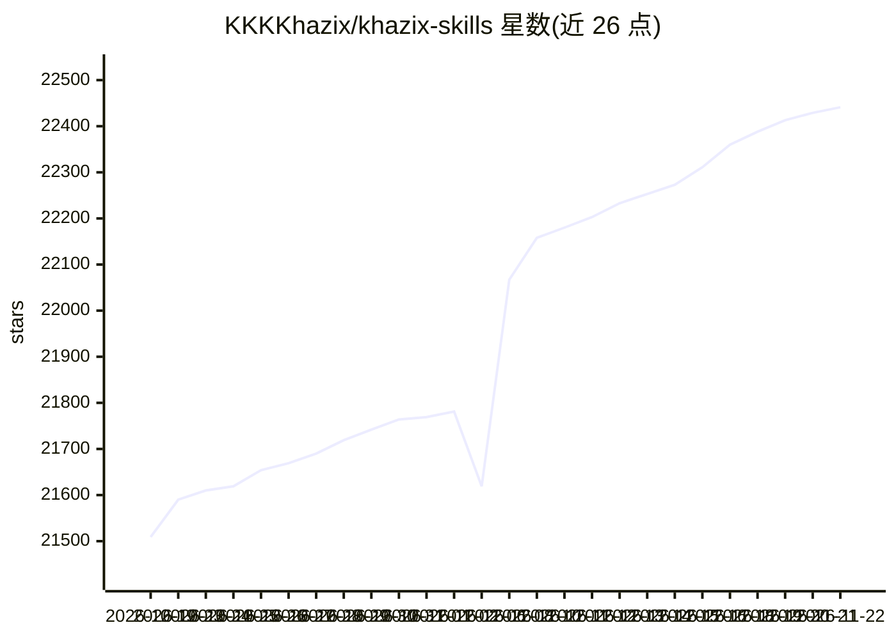

# KKKKhazix/khazix-skills

⭐ 22,441 · Python · MIT · 推送 2026-11-18 · [GitHub](https://github.com/KKKKhazix/khazix-skills) · 个人维护 · 中文 README

**面向 Agent 用户的六个开源 AI Skills 合集**

数字生命卡兹克开源的六个 Agent Skill：leader 目标定义、storage-analyzer 磁盘扫描清理、aihot AI 资讯查询、neat-freak 项目文档与记忆整理、hv-analysis 横纵研究报告、khazix-writer 个人风格写作。每个 Skill 是遵循 Agent Skills 开放标准的结构化指令集，Claude Code、Codex、Cursor 等 40+ 支持该标准的 Agent 均可加载。安装方式包括让 Agent clone 仓库目录、手动复制到 skills 目录，或以 Claude Code / Codex 插件形式安装与更新；普通聊天模型无文件或联网工具时无法使用部分功能。

## 筛选速览

| 维度 | 判定 | 备注 |
|---|---|---|
| AI 角色 | `ai-knowledge` | 知识聚合/清单类 |
| 许可风险 | `permissive` | MIT |
| 部署形态 | `None` |  |
| 模型依赖 | — | README 未给出锁定关系 |
| 硬件要求 | — | 无带数字的原话,不猜 |
| 安装摩擦 | `low` | 无编译、无系统依赖或容器化 |
| 成熟度 | — | 结构信号不足 |

## 动量与使用信号

- 维护:`active` — 距上次 push 16.8 天,年发版 0,1 位贡献者
- 涨星:近 1 天 **+39**(自 20261016 起算)
- 平台:WINDOWS / MACOS · 协议:MCP

## 能力要点

- 六个遵循 Agent Skills 开放标准的结构化指令集，兼容 40+ Agent
- leader 产出 Markdown 任务书，供目标模式 Agent 长程执行
- storage-analyzer 全程只读扫描，三色分级清理决策
- 支持插件市场安装与版本更新（Claude Code / Codex）

## 适用场景

- 让 Agent 把模糊想法定义成可独立执行的目标任务书
- 一句话扫描 Mac/Windows/Linux 磁盘并生成交互式清理报告
- 让 Agent 收尾时对齐项目文档、规则文件与自身记忆
- 调研产品/公司并生成带来源清单的研究报告

## 场景标签

`科研工具` `AI 写作` · 领域:内容生成

## 证据(README 行号)

> L17: 这里的每个 Skill 都是 Agent 能直接加载的结构化指令集，遵循 Agent Skills 开放标准。Claude Code、Codex、Qoder、Kimi Code、iFlow、CodeBuddy、Cursor 等 4
> L40: 安装时保留整个 Skill 目录，包括 `references/`、`scripts/`、`assets/` 和 `agents/`（如有）。只粘贴 `SKILL.md` 可以参考方法，但不能替代配套脚本和资源。普通聊天模型没有文

## 星数曲线

2026-10-19 21,509 → 2026-11-22 22,441（+932）

---
*卡片 v1 · prompt 1.4 · 生成 2026-11-22 · 置信度 high · 依据 README sha `c08576583a93` · [字段定义](../../DATASET.md)*
