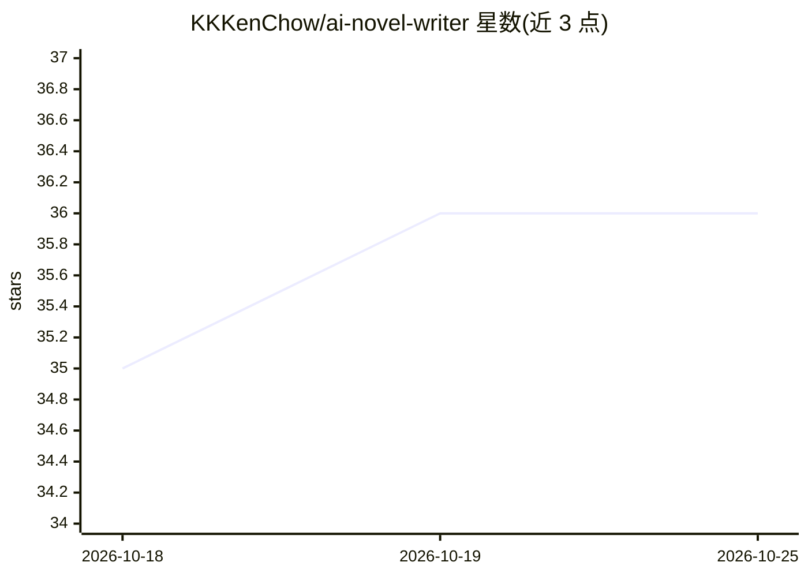

# KKKenChow/ai-novel-writer

⭐ 36 · Python · MIT · 推送 2026-09-09 · [GitHub](https://github.com/KKKenChow/ai-novel-writer) · 个人维护 · 中文 README

**面向个人作者的 AI 全流程小说创作 Web 工具**

基于 FastAPI + 单页 H5 的小说创作应用：按世界观→人物→大纲→章节→续写/润色的严格顺序流程，调用 OpenAI 格式 API 生成内容。长篇一致性靠本地 JSON 结构化记忆注入（台账/摘要/伏笔），采用无状态单轮调用，配合六阶段节奏控制与四级剧透过滤。所有数据本地 JSON 持久化，支持 Markdown/docx/EPUB 导出；需自备一个大模型 API Key，默认火山方舟豆包 API。

## 筛选速览

| 维度 | 判定 | 备注 |
|---|---|---|
| AI 角色 | `ai-native` | 本体是模型或模型工具 |
| 许可风险 | `permissive` | MIT |
| 部署形态 | `library` | 以包/库形式分发 |
| 模型依赖 | — | README 未给出锁定关系 |
| 硬件要求 | — | 无带数字的原话,不猜 |
| 安装摩擦 | `low` | 无编译、无系统依赖或容器化 |
| 成熟度 | — | 结构信号不足 |

## 能力要点

- 世界观→人物→大纲→章节的顺序化全流程创作
- 本地 JSON 结构化记忆注入维持长篇一致性，无状态单轮调用
- 六阶段渐进节奏控制与四级剧透过滤
- Skill 技能包装载/蒸馏，及 docx/EPUB 导出

## 适用场景

- 低成本生成并管理长篇网文小说
- 维护百万字长篇的人物状态与伏笔回收
- 模仿指定作家风格润色并降低 AI 痕迹

## 场景标签

`AI 写作` · 领域:内容生成

## 证据(README 行号)

> L1: # 📖 AI 全链路小说创作工具
> L11: - 🔗 **全链路创作**：从世界观设定 → 人物设计 → 大纲规划 → 逐章生成 → 续写/润色，完整流程
> L21: - 🔌 **通用兼容**：默认火山方舟豆包API（按量付费，完全合规），也可接任何OpenAI格式API

## 星数曲线

2026-10-18 35 → 2026-10-25 36（+1）

---
*卡片 v1 · prompt 1.4 · 生成 2026-10-25 · 置信度 mid · 依据 README sha `a7eaa18830a0` · [字段定义](../../DATASET.md)*
