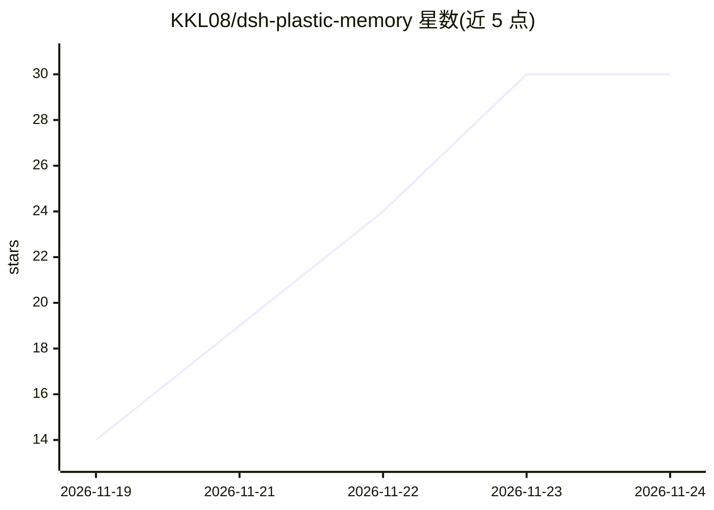

# KKL08/dsh-plastic-memory

⭐ 31 · TypeScript · MIT · 推送 2026-11-23 · [GitHub](https://github.com/KKL08/dsh-plastic-memory) · 个人维护 · 中文 README

**为 DeepSeek Harness 提供自动沉淀、检索与治理的长期记忆插件**

面向 DeepSeek Harness 的插件，覆盖记忆全生命周期：对话中自动记录用户偏好、项目背景与经验教训并标记来源（用户明确提出或模型推测）；新对话自动注入核心记忆与索引，过程中按需检索并下钻到原始出处；通过健康体检检测重复、矛盾、过期、冗长问题并给出评分与建议，关键决策由用户确认。记忆以 Markdown 文件本地存储，含密钥拦截与遮盖机制，内置通用/编码/办公三种模式，注入预算与巡检灵敏度可配置。

## 筛选速览

| 维度 | 判定 | 备注 |
|---|---|---|
| AI 角色 | `ai-ecosystem` | LLM/agent 周边工具 |
| 许可风险 | `permissive` | MIT |
| 部署形态 | `None` |  |
| 模型依赖 | locked-api |  |
| 硬件要求 | — | 无带数字的原话,不猜 |
| 安装摩擦 | `low` | 无编译、无系统依赖或容器化 |
| 成熟度 | `idea` | |

## 能力要点

- 记忆自动沉淀并标记来源（明确提出/观察推测），以本地 Markdown 文件按项目存放
- 新对话自动注入核心记忆与索引，过程中动态按需检索并支持溯源下钻
- 定期体检检测重复、矛盾、过期、冗长问题，给出健康评分与处理建议
- 密钥信息写入拦截与展示遮盖，记忆本地存储于 ~/.dsh/memories

## 适用场景

- 让 Agent 在日常协作中记住我的偏好和项目背景，新对话不用重复交代
- 定期清理记忆库里的矛盾和过期内容，避免模型被劣化记忆带偏
- 查看每条对话实际带入了哪些记忆，控制上下文用量

## 场景标签

`Agent 记忆` · 领域:Agent 开发

## 证据(README 行号)

> L17: 这是一款面向 DeepSeek Harness 的长期记忆插件，集记忆的自动沉淀、按需唤起与质量维护于一体。它能在日常对话与任务中记下值得保存的关键信息，在后续协作中适时提供上下文背景，并通过健康监测机制持续维护记忆内容质量。
> L88: |基本架构和工具|记忆怎么写入、带入、治理，以及模型能用的九个工具|

## 星数曲线

2026-11-19 14 → 2026-11-24 30（+16）

---
*卡片 v1 · prompt 1.4 · 生成 2026-11-19 · 置信度 high · 依据 README sha `0a2fe15558f0` · [字段定义](../../DATASET.md)*
