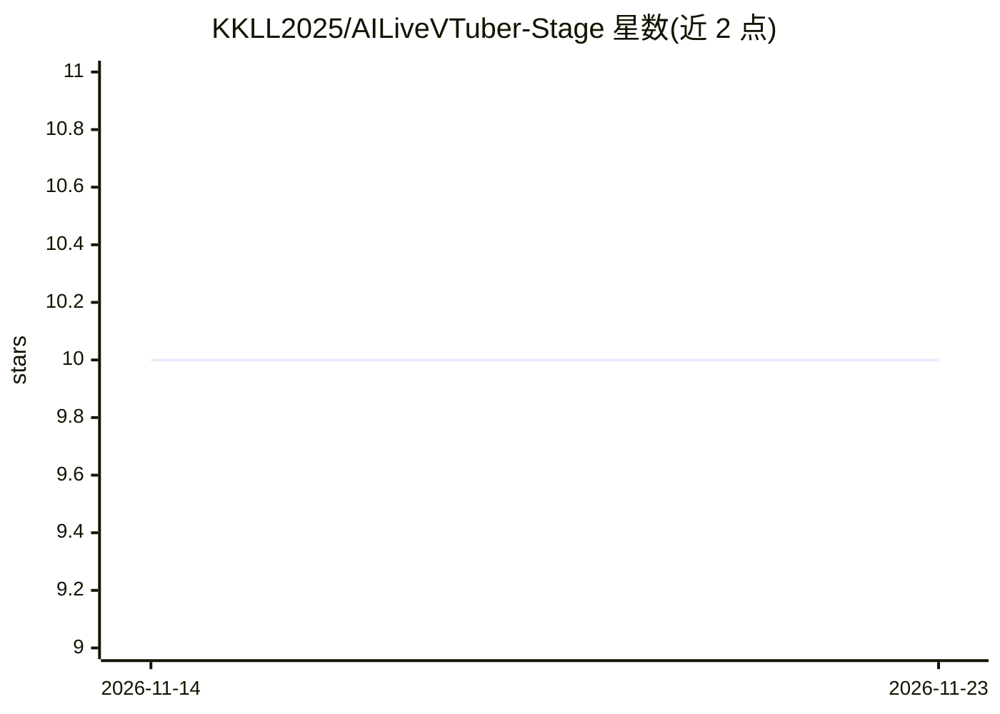

# KKLL2025/AILiveVTuber-Stage

⭐ 10 · Python · MIT · 推送 2026-08-05 · [GitHub](https://github.com/KKLL2025/AILiveVTuber-Stage) · 个人维护 · 中文 README

**本地 Live2D AI 虚拟主播舞台：LLM 回复+TTS+弹幕 UI**

本地运行的 Live2D 虚拟主播系统：接入 B 站直播间事件（弹幕、礼物、SC、上舰等），用 DeepSeek 生成带情绪和动作标签的角色回复，通过小米 MiMo TTS 合成语音，在自制直播舞台中驱动 Live2D 口型、表情、字幕与弹幕 UI。含回应优先级队列、多层记忆（直播阶段/角色/付费用户/下播固化）与 Studio 调试控制台。需 Python 3.11 与 Node 24，Live2D 模型与 Cubism Core 需自行获取，模型替换需手动调整多处配置，非一键替换框架。

## 筛选速览

| 维度 | 判定 | 备注 |
|---|---|---|
| AI 角色 | `ai-native` | 本体是模型或模型工具 |
| 许可风险 | `permissive` | MIT |
| 部署形态 | `library` | 以包/库形式分发 |
| 模型依赖 | locked-api |  |
| 硬件要求 | — | 无带数字的原话,不猜 |
| 安装摩擦 | `low` | 无编译、无系统依赖或容器化 |
| 成熟度 | — | 结构信号不足 |

## 能力要点

- 弹幕/礼物/SC 等直播事件统一输入管线与优先级回应队列
- DeepSeek 生成回复并输出情绪标签与动作标签驱动 Live2D
- 多层记忆：直播阶段记忆、角色记忆、付费用户长期记忆与下播固化
- Studio 控制台支持调试输入、预设事件与舞台预览

## 适用场景

- 在 B 站直播间搭建由 LLM 驱动的 Live2D 虚拟主播
- 为直播舞台配置弹幕面板、字幕与情绪动作表现
- 本地调试与预览 AI 主播的回应流程

## 场景标签

`Agent 记忆` `语音合成` · 领域:Agent 开发

## 证据(README 行号)

> L5: 一个本地运行的 Live2D 虚拟主播系统：接入直播间事件，使用 DeepSeek 生成回复，通过 MiMo TTS 合成语音，并在自制直播舞台中驱动 Live2D 表情、动作、字幕和弹幕 UI。
> L39: - LLM 回复链路：使用 DeepSeek 生成角色回复、情绪标签和动作标签

## 星数曲线

2026-11-14 10 → 2026-11-23 10（+0）

---
*卡片 v1 · prompt 1.4 · 生成 2026-11-20 · 置信度 high · 依据 README sha `85405b12d604` · [字段定义](../../DATASET.md)*
