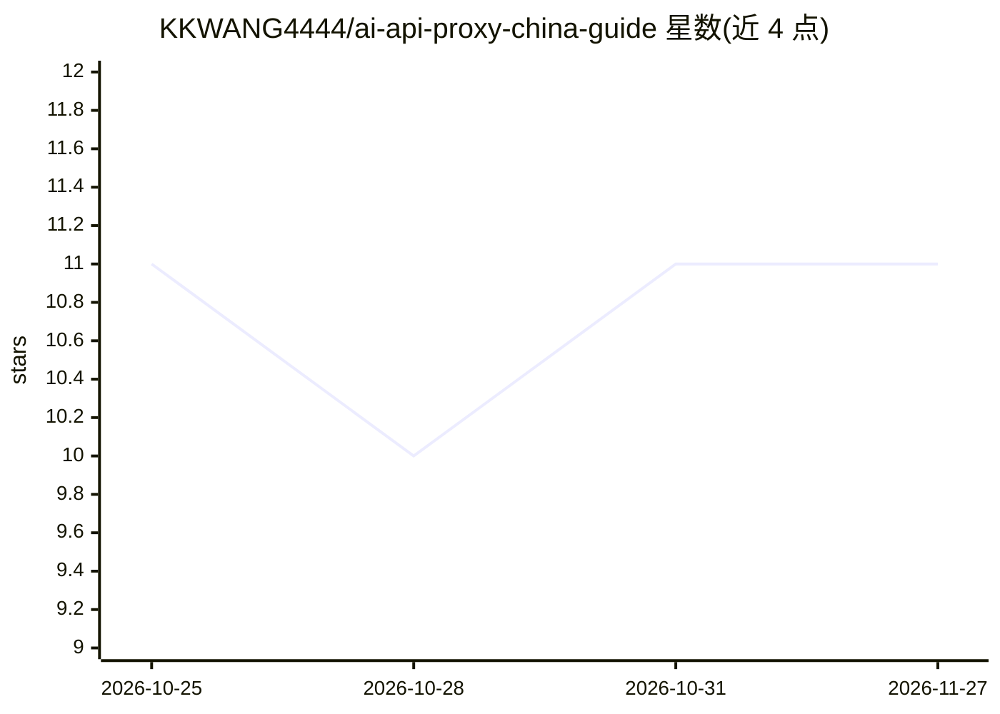

# KKWANG4444/ai-api-proxy-china-guide

⭐ 11 · JavaScript · MIT · 推送 2026-11-22 · [GitHub](https://github.com/KKWANG4444/ai-api-proxy-china-guide) · [官网](https://docs.aifast.hk/start/?utm_source=github&utm_medium=repository&utm_campaign=developer_acquisition&utm_content=repo-about-guide) · 组织维护 · 中文 README

**国内开发者接入 AI API 中转站的配置与排错指南**

面向国内开发者的 AI API 中转接入文档，覆盖 OpenAI-compatible Base URL 配置、最小请求示例，以及 Cursor、Claude Code、Codex CLI、Dify 等工具的接入步骤；提供浏览器在线接口检测（协议、SSE、工具调用分项报告）、Base URL 检查器、Token 成本计算器、错误排查（401/404/429/5xx）与上线前检查表。附带的 AI快站为文档维护者自有服务，README 明确披露该关系。

## 筛选速览

| 维度 | 判定 | 备注 |
|---|---|---|
| AI 角色 | `ai-knowledge` | 知识聚合/清单类 |
| 许可风险 | `permissive` | MIT |
| 部署形态 | `None` |  |
| 模型依赖 | — | README 未给出锁定关系 |
| 硬件要求 | — | 无带数字的原话,不猜 |
| 安装摩擦 | `low` | 无编译、无系统依赖或容器化 |
| 成熟度 | — | 结构信号不足 |

## 能力要点

- OpenAI-compatible Base URL 与最小请求的复制式接入步骤
- 浏览器在线检测：模型声明、Token、SSE、工具调用分项报告
- 按问题索引的排错教程：/v1/v1、401、429、5xx 专项页
- 生产验收矩阵与回退策略（应用侧定义模型组并记录响应模型）

## 适用场景

- 第一次接入 OpenAI-compatible 中转接口并跑通最小请求
- 排查现有接口的鉴权、流式或工具调用问题
- 配置 Cursor、Claude Code、Codex CLI 使用自定义 Base URL
- 比较中转服务前按 12 项清单实测接口能力与成本

## 场景标签

`教程课程` · 领域:学习与行业

## 证据(README 行号)

> L12: 这是一份面向国内开发者的 AI API 中转站接入指南，覆盖 OpenAI API 中转、Claude API 中转、Gemini API 中转，以及 Cursor、Dify、Claude Code、Codex 等工具的 Open
> L282: **披露：** 本仓库由 AI快站运营者维护。文中涉及 AI快站的内容属于自有服务说明，生产选型仍应以真实测试、服务条款和当前控制台信息为准。

## 星数曲线

2026-10-25 11 → 2026-11-27 11（+0）

---
*卡片 v1 · prompt 1.4 · 生成 2026-11-19 · 置信度 high · 依据 README sha `214ad7cc13a8` · [字段定义](../../DATASET.md)*
