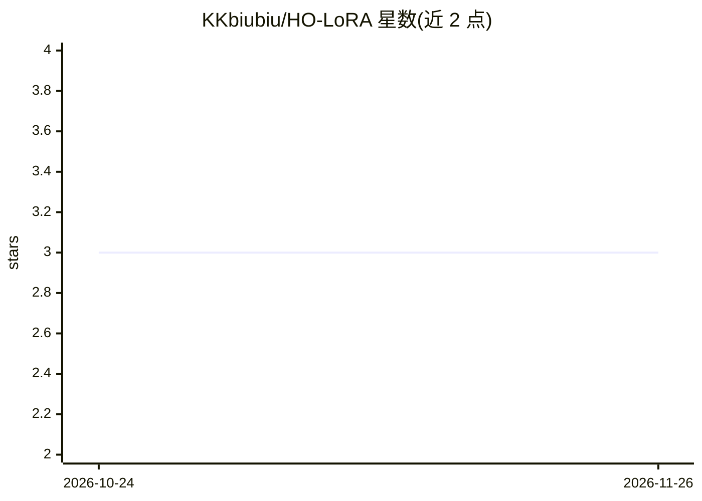

# KKbiubiu/HO-LoRA

⭐ 3 · Python · NOASSERTION · 推送 2026-10-13 · [GitHub](https://github.com/KKbiubiu/HO-LoRA) · 个人维护

**SDXL 上分离内容/颜色/纹理风格的三分支 LoRA 训练与评估实现**

提供 HO-LoRA 方法的核心训练与评估实现：将 SDXL U-Net 适配器分配到 Content、Color、Texture 三个分支，采用四阶段训练循环与正交正则化。仓库附 12 张 1024×1024 原分辨率结果图、6 份评估 JSON、评估指标（颜色直方图距离、Edge IoU、VGG19 Gram 距离、ΔT）及仅依赖标准库的汇总工具。训练图像与模型权重不分发，数据加载与完整生成流程不在本仓库范围。

## 筛选速览

| 维度 | 判定 | 备注 |
|---|---|---|
| AI 角色 | `ai-native` | 本体是模型或模型工具 |
| 许可风险 | `none` | NOASSERTION |
| 部署形态 | `library` | 以包/库形式分发 |
| 模型依赖 | — | README 未给出锁定关系 |
| 硬件要求 | — | 无带数字的原话,不猜 |
| 安装摩擦 | `medium` | 含编译或系统依赖之一 |
| 成熟度 | — | 结构信号不足 |

## 能力要点

- 三分支（Content/Color/Texture）LoRA 适配器与四阶段训练循环
- 评估核心含颜色直方图距离、Edge IoU、VGG19 Gram 距离与 ΔT 指标
- 附 12 张结果图、6 份评估 JSON 与可复现的汇总验证工具
- 汇总工具仅用 Python 标准库，无需 GPU 或模型下载

## 适用场景

- 研究 SDXL 上内容与风格属性的分层适配器控制
- 复现仓库记录的评估表格与 ΔT 计算
- 以分支化 LoRA 进行绘画风格迁移实验

## 场景标签

`微调` · 领域:训练与推理

## 证据(README 行号)

> L19: HO-LoRA explores fine-grained style control by assigning SDXL U-Net adapters to three composable branches: **Conten
> L29: |Training core|Branch-specific LoRA, four phases and orthogonal regularization|

## 星数曲线

2026-10-24 3 → 2026-11-26 3（+0）

---
*卡片 v1 · prompt 1.4 · 生成 2026-11-22 · 置信度 high · 依据 README sha `d4bb0740354a` · [字段定义](../../DATASET.md)*
