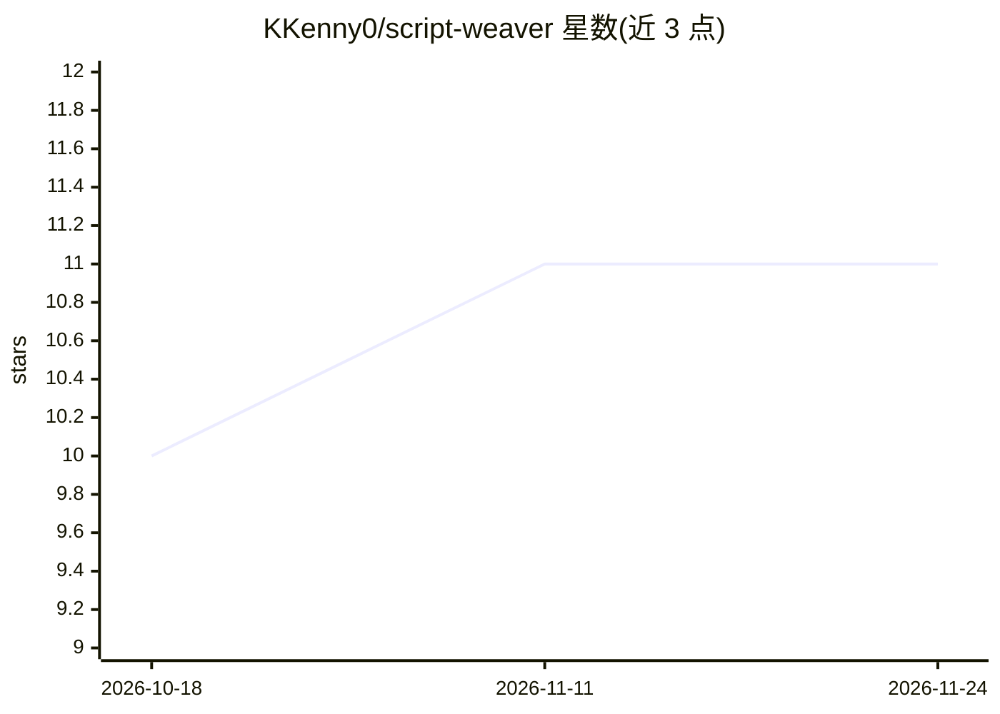

# KKenny0/script-weaver

⭐ 11 · Python · 推送 2026-11-15 · [GitHub](https://github.com/KKenny0/script-weaver) · 个人维护 · 中文 README

**将故事创意转为剧本与AI视频提示词的多Agent引擎**

Script-Weaver 是一个剧本与分镜生成引擎：输入 logline 或设定，通过 9 个自治 Agent（创意细化、结构化、角色/场景设计、艺术指导、编剧、分镜等）协作产出节拍大纲、角色表、Fountain/ScreenJSON 标准剧本及逐镜头视频提示词。内置技能注册表（Save the Cat、Dan Harmon 故事环等），支持 YAML/Claude Code .md 格式自定义技能，含项目记忆、用户画像与技能自进化三层机制。提供 Next.js Web 工作台与 CLI 双界面，SQLite 持久化、CAS 版本控制、SSE 流式与断点续跑。

## 筛选速览

| 维度 | 判定 | 备注 |
|---|---|---|
| AI 角色 | `ai-native` | 本体是模型或模型工具 |
| 许可风险 | `none` | — |
| 部署形态 | `library` | 以包/库形式分发 |
| 模型依赖 | local-ok | 支持本地模型 |
| 硬件要求 | — | 无带数字的原话,不猜 |
| 安装摩擦 | `low` | 无编译、无系统依赖或容器化 |
| 成熟度 | — | 结构信号不足 |

## 能力要点

- 9 个自治 Agent 多智能体协作管线，各带工具使用推理循环
- VideoGen 导出器生成首帧图像提示与时序运动提示，适配多款视频模型
- 可插拔技能注册表，兼容原生 YAML、JSON 与 Claude Code .md 技能
- SQLite + CAS 版本控制、后台运行 SSE 流式、--resume 原子断点续跑

## 适用场景

- 从一个故事点子自动生成完整剧本与分镜资产
- 批量产出可直接粘贴到视频生成模型的逐镜头提示词
- 沉淀个人叙事偏好并让技能随使用自我优化

## 场景标签

`多智能体` `提示工程` · 领域:Agent 开发

## 证据(README 行号)

> L5: > **Agent-Native Screenplay & Storyboard Generation Engine** — An autonomous AI creative pipeline that transforms ra
> L14: - 🤖 **9 Specialized Autonomous Agents**: Features a multi-agent cooperative architecture (Idea Refiner, Structurer,
> L66: Script-Weaver supports leading cloud providers and local open-source models out of the box:

## 星数曲线

2026-10-18 10 → 2026-11-24 11（+1）

---
*卡片 v1 · prompt 1.4 · 生成 2026-11-19 · 置信度 mid · 依据 README sha `89f9306c3cbd` · [字段定义](../../DATASET.md)*
