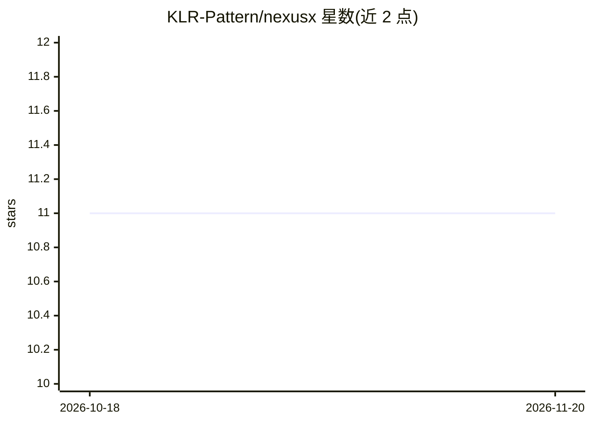

# KLR-Pattern/nexusx

⭐ 11 · Python · MIT · 推送 2026-11-18 · [GitHub](https://github.com/KLR-Pattern/nexusx) · [官网](https://klr-pattern.github.io/nexusx/) · 个人维护 · 中文 README

**为开发者从单一 SQLModel 模型生成 MCP/GraphQL/REST/CLI 的 Python 框架**

Python 框架，用于构建 MCP-first、Agent-first 应用：开发者声明 SQLModel 实体、DefineSubset DTO 与用例方法后，框架据此派生 GraphQL schema、REST 路由、MCP 工具、CLI 命令与 TypeScript SDK，共享同一 DataLoader 查询图（按层级批量加载）与类型化 DTO。面向 agent 的机制包括字段感知、渐进式 schema 披露与字段级选择，以减少上下文占用。要求 Python 3.10+；MCP、federation、CLI 为可选 extra。

## 筛选速览

| 维度 | 判定 | 备注 |
|---|---|---|
| AI 角色 | `ai-ecosystem` | LLM/agent 周边工具 |
| 许可风险 | `permissive` | MIT |
| 部署形态 | `library` | 以包/库形式分发 |
| 模型依赖 | — | README 未给出锁定关系 |
| 硬件要求 | — | 无带数字的原话,不猜 |
| 安装摩擦 | `low` | 无编译、无系统依赖或容器化 |
| 成熟度 | — | 结构信号不足 |

## 能力要点

- 单一 SQLModel 模型派生 GraphQL/REST/MCP/CLI/TS SDK 多协议
- MCP 为一等协议：get_schema 与 graphql_query 两工具渐进发现
- DataLoader 批量加载，查询数随图深度而非行数增长
- npx skills 安装 4phase 技能，可由编码 agent 单提示词构建应用

## 适用场景

- 为 AI agent 提供可渐进探索、按字段取数的业务数据 API
- 消除 FastAPI+SQLModel 项目中多传输层的重复模型声明
- 让人类与 agent 通过同一棵树实时协同编辑（如 MindMap X 示例）
- 用 CLI 命令带 --select 字段投影调试业务用例

## 场景标签

`代码生成` · 领域:编码与开发

## 证据(README 行号)

> L10: nexusx is a Python framework for building **MCP-first, Agent-first
> L31: **For AI** — nexusx builds **agent-first APIs**: MCP is a first-class protocol
> L50: **For Human** — write SQLModel entities + typed DTOs; get REST routes, GraphQL

## 星数曲线

2026-10-18 11 → 2026-11-20 11（+0）

---
*卡片 v1 · prompt 1.4 · 生成 2026-11-19 · 置信度 mid · 依据 README sha `3d683df746d5` · [字段定义](../../DATASET.md)*
