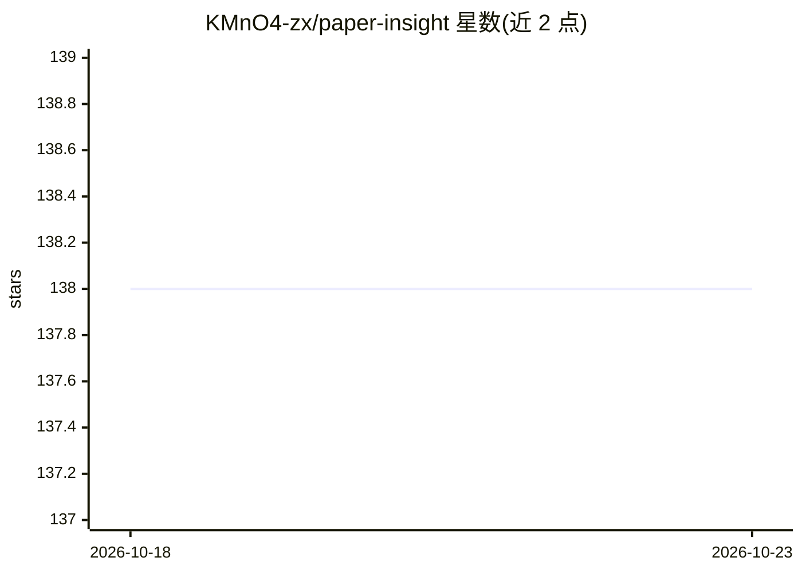

# KMnO4-zx/paper-insight

⭐ 138 · TypeScript · Apache-2.0 · 推送 2026-08-13 · [GitHub](https://github.com/KMnO4-zx/paper-insight) · [官网](https://paper-insight.herobase.tech/) · 个人维护 · 中文 README

**帮研究者快速初筛 AI 会议论文并管理精读候选的工具**

面向 AI 会议论文的筛选与分析工具：使用 LLM 对论文生成围绕代码开源、任务、评估指标、相对 baseline 贡献四个问题的分析，用于判断论文是否值得精读；支持按会议（ICLR/CHI/CVPR/NeurIPS/ICML）批量浏览、Hugging Face Daily Papers 同步与 arXiv 链接分析，并提供论文全文多轮对话、个人论文库、GitHub 登录与后台管理。定位为快速筛选而非替代精读，筛选后可收藏到 Zotero。提供在线版本，本地部署需按 develop.md 配置 PostgreSQL、config.yaml、GitHub OAuth，支持 Docker/VPS 部署，Apache 2.0 许可。

## 筛选速览

| 维度 | 判定 | 备注 |
|---|---|---|
| AI 角色 | `ai-native` | 本体是模型或模型工具 |
| 许可风险 | `permissive` | Apache-2.0 |
| 部署形态 | `None` |  |
| 模型依赖 | — | README 未给出锁定关系 |
| 硬件要求 | — | 无带数字的原话,不猜 |
| 安装摩擦 | `low` | 无编译、无系统依赖或容器化 |
| 成熟度 | — | 结构信号不足 |

## 能力要点

- 默认分析回答 4 个筛选问题：代码开源、任务、评估指标、相对 baseline 的原因
- 会议批量浏览（分页/关键词搜索/字段过滤）+ Daily Papers 同步 + arXiv 链接分析
- 基于论文正文的多轮对话并保存历史会话
- GitHub 登录、用户管理、个人论文库与手动触发同步任务

## 适用场景

- 每天面对大量候选论文时先判断哪几篇值得精读
- 按会议批量浏览和搜索 AI 会议论文
- 和某篇论文对话追问方法细节与复现路径，再决定是否收藏到 Zotero

## 场景标签

`科研工具` · 领域:学习与行业

## 证据(README 行号)

> L12: Paper Insight 是一个面向 AI 会议论文的快速筛选与分析工具。它使用 LLM 对论文生成简洁分析，帮助你先判断一篇论文是否值得精读，再决定是否收藏到 Zotero 或继续深入阅读。
> L39: - 快速分析：围绕代码、任务、指标、baseline 给出更适合初筛的摘要。

## 星数曲线

2026-10-18 138 → 2026-10-23 138（+0）

---
*卡片 v1 · prompt 1.4 · 生成 2026-10-23 · 置信度 high · 依据 README sha `d6a79de96503` · [字段定义](../../DATASET.md)*
