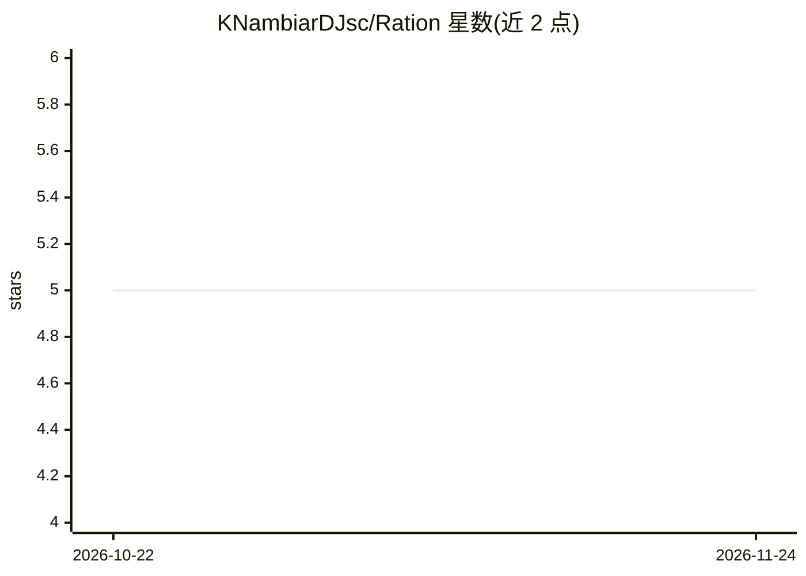

# KNambiarDJsc/Ration

⭐ 5 · Python · MIT · 推送 2026-10-13 · [GitHub](https://github.com/KNambiarDJsc/Ration) · 个人维护

**面向编码 agent 的本地用量控制台：看住配额与预算**

一个 Python CLI（包名 ration-cli），为 Claude Code 与 Codex 用户提供推理用量管理：governed 自动压缩窗口选型、xray 用量去向分析、handoff 无模型重启套件、会话内模型/effort 建议、卡死检测，以及 budget-aware 的任务运行与空闲算力调度。所有分析仅读取本地会话记录，不调用模型、不联网；handoff/governor 等核心命令零模型调用，任务运行按预算分级选模型并用 git worktree 隔离验证。

## 筛选速览

| 维度 | 判定 | 备注 |
|---|---|---|
| AI 角色 | `ai-ecosystem` | LLM/agent 周边工具 |
| 许可风险 | `permissive` | MIT |
| 部署形态 | `library` | 以包/库形式分发 |
| 模型依赖 | — | README 未给出锁定关系 |
| 硬件要求 | — | 无带数字的原话,不猜 |
| 安装摩擦 | `low` | 无编译、无系统依赖或容器化 |
| 成熟度 | — | 结构信号不足 |

## 能力要点

- 基于真实会话回放推荐 auto-compact 窗口（governor），可 apply/status/revert
- xray 只读本地会话，量化 token 用量去向（如上下文重读占比）
- handoff 无模型生成重启套件，/clear 后不丢上下文
- budget-aware 任务运行：先跑 --check 再花费，分级升级模型并在 git worktree 中验证

## 适用场景

- 长会话下分析 Claude Code 配额都花在哪里
- 为 /clear 生成会话摘要套件避免丢线索
- 在 5 小时窗口紧张时按预算自动选便宜模型跑任务
- 离开电脑时把空闲配额转化为带验证的代码任务

## 场景标签

`LLM 可观测性` · 领域:评测与运维

## 证据(README 行号)

> L5: The inference control plane for coding agents.
> L121: **How it stays accurate, with local data only (no APIs, no LLM calls):**

## 星数曲线

2026-10-22 5 → 2026-11-24 5（+0）

---
*卡片 v1 · prompt 1.4 · 生成 2026-11-21 · 置信度 high · 依据 README sha `eb1f63a032cf` · [字段定义](../../DATASET.md)*
