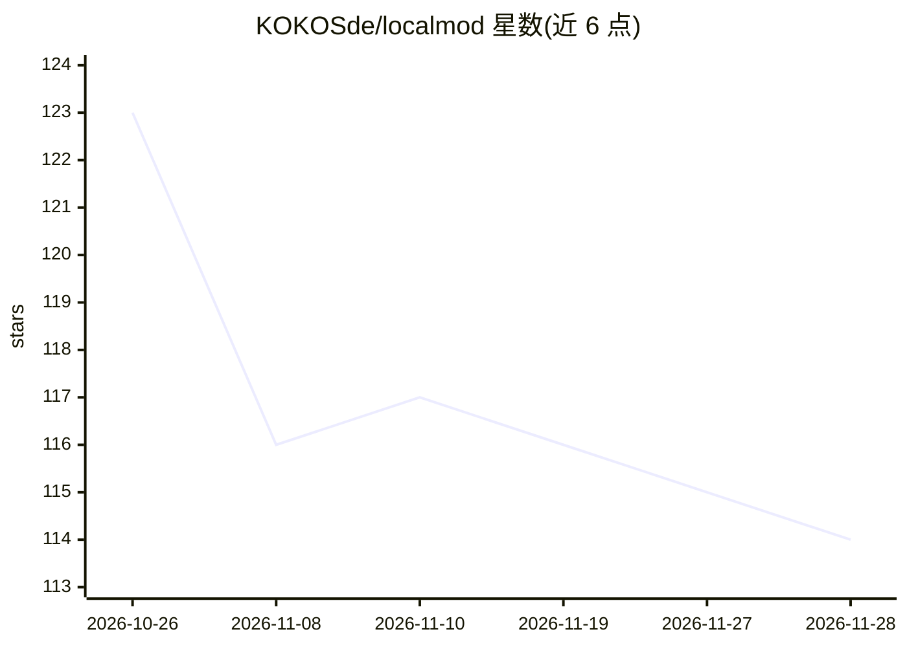

# KOKOSde/localmod

⭐ 114 · Python · MIT · 推送 2026-10-31 · [GitHub](https://github.com/KOKOSde/localmod) · 个人维护

**自托管内容审核 API：本地离线检测文本/图片违规内容**

以 FastAPI 服务形式提供的自托管内容审核系统，完全离线运行，数据不出自建服务器。文本侧提供 PII（正则+校验）、毒性（4 模型加权集成）、提示注入（DeBERTa）、垃圾信息（RoBERTa）、NSFW 文本五类分类器；图片侧基于 ViT 模型检测 NSFW。通过 git clone 安装后需下载约 3.5GB 模型，支持 Docker 部署与 Discord 机器人集成，暴露 /analyze、/redact、/analyze/image 等 REST 端点，设备可选 cpu/cuda。README 附带基于公开数据集的基准表与性能延迟数据。

## 筛选速览

| 维度 | 判定 | 备注 |
|---|---|---|
| AI 角色 | `ai-native` | 本体是模型或模型工具 |
| 许可风险 | `permissive` | MIT |
| 部署形态 | `self-host` | docker 或自建部署 |
| 模型依赖 | — | README 未给出锁定关系 |
| 硬件要求 | — | 无带数字的原话,不猜 |
| 安装摩擦 | `low` | 无编译、无系统依赖或容器化 |
| 成熟度 | — | 结构信号不足 |

## 能力要点

- 文本 5 类分类器（PII/毒性/提示注入/垃圾信息/NSFW）+ 图片 NSFW 检测
- 完全离线运行，支持 LOCALMOD_OFFLINE 强制离线模式
-  toxicity 采用 4 模型加权集成（toxic-bert 50% 等）
- 提供 REST API、Python 库、Docker 镜像与 Discord 机器人四种使用方式

## 适用场景

- 为自建社区/Discord 服务器提供本地化的文本与图片审核
- 在不外发数据的前提下检测并脱敏文本中的 PII
- 拦截针对 LLM 应用的提示注入/越狱输入

## 场景标签

`网络安全` · 领域:学习与行业

## 证据(README 行号)

> L7: **Fully offline content moderation API** — Free, self-hosted, and private. Your data never leaves your infrastructur
> L99: |**Toxicity**|Hate speech, harassment, threats|Weighted Ensemble (4 models)|
> L188: |`LOCALMOD_DEVICE`|`auto`|`cpu`, `cuda`, or `auto`|

## 星数曲线

2026-10-26 123 → 2026-11-28 114（-9）

---
*卡片 v1 · prompt 1.4 · 生成 2026-11-28 · 置信度 high · 依据 README sha `79dcf0c62ed6` · [字段定义](../../DATASET.md)*
