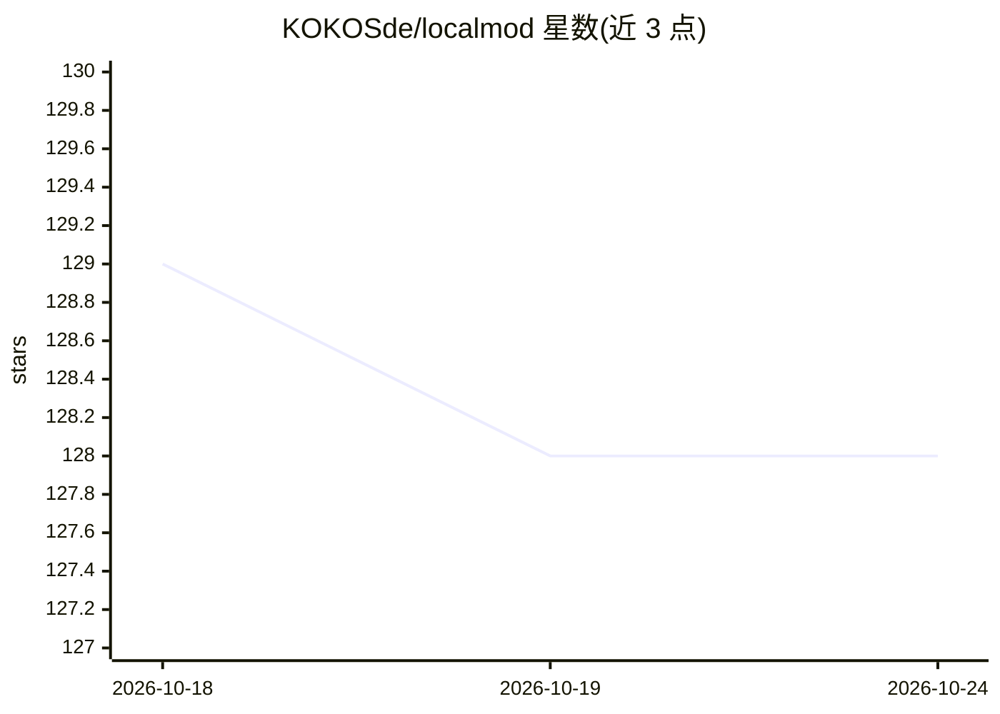

# KOKOSde/localmod

⭐ 123 · Python · MIT · 推送 2026-10-22 · [GitHub](https://github.com/KOKOSde/localmod) · 个人维护

**自托管离线内容审核 API：文本与图像的毒性/PII/NSFW 检测**

基于 FastAPI 的本地内容审核服务，数据不出自有基础设施。文本侧提供 PII（正则+校验）、毒性（4 模型加权集成）、提示注入（DeBERTa）、垃圾信息（RoBERTa）、NSFW 文本共 5 类分类器；图像侧用 ViT 模型检测 NSFW 图片。提供 REST 端点（分析/批量/PII 脱敏/图像分析）与 Discord 机器人集成，支持 Docker 与完全离线模式（预下载约 3.5GB 模型）。附 CHI 2025 方法论的基准数据。需 Python 3.8+，设备支持 cpu/cuda/auto。

## 筛选速览

| 维度 | 判定 | 备注 |
|---|---|---|
| AI 角色 | `ai-native` | 本体是模型或模型工具 |
| 许可风险 | `permissive` | MIT |
| 部署形态 | `self-host` | docker 或自建部署 |
| 模型依赖 | — | README 未给出锁定关系 |
| 硬件要求 | — | 无带数字的原话,不猜 |
| 安装摩擦 | `low` | 无编译、无系统依赖或容器化 |
| 成熟度 | — | 结构信号不足 |

## 能力要点

- 5 类文本分类器 + 1 类图像分类器（毒性为 4 模型加权集成）
- 完全离线运行，模型预下载至本地目录
- REST API 提供 /analyze、/redact、图像分析等端点，另有 Discord 机器人集成
- 发布 CHI 2025 方法论基准与各类分类器的 P/R/F1 指标

## 适用场景

- 在自有服务器上对用户生成内容做毒性与 NSFW 审核，数据不出内网
- 从文本中检测并脱敏 PII（邮箱/电话/社保号/信用卡）
- 为 LLM 应用检测提示注入攻击
- 给 Discord 服务器部署自动删帖与禁言的实时审核机器人

## 场景标签

`网络安全` · 领域:学习与行业

## 证据(README 行号)

> L7: **Fully offline content moderation API** — Free, self-hosted, and private. Your data never leaves your infrastructur
> L98: |**PII**|Emails, phones, SSNs, credit cards|Regex + Validation|

## 星数曲线

2026-10-18 129 → 2026-10-24 128（-1）

---
*卡片 v1 · prompt 1.4 · 生成 2026-10-22 · 置信度 high · 依据 README sha `4dafd4249567` · [字段定义](../../DATASET.md)*
