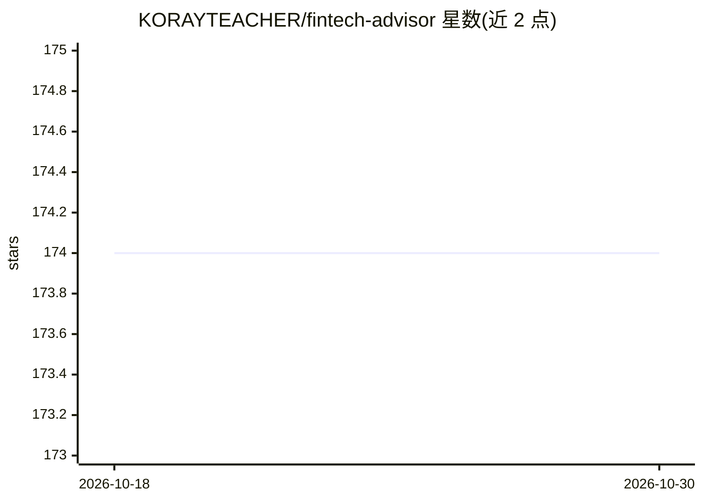

# KORAYTEACHER/fintech-advisor

⭐ — · [GitHub]() · 个人维护

**带 AI 顾问的个人净资产跟踪应用（Foliofox）**

Foliofox 是自托管的净资产跟踪 Web 应用：以图表和表格展示组合资产，支持多币种自动汇率、通过 AI 从任意券商或表格一键导入持仓、基于 Yahoo Finance 的每日市场数据，并由 AI 聊天接口提供个性化财务建议。数据存储于用户自己的 Supabase 项目。技术栈为 Next.js 16、TypeScript、Supabase、Tailwind CSS；可选 Redis 做 AI 路由的分布式限流，未配置时回退到进程内计数器。README 明确声明它不是预算或支出跟踪应用。以 Docker Compose 方式部署运行。

## 筛选速览

| 维度 | 判定 | 备注 |
|---|---|---|
| AI 角色 | `ai-enhanced` | 去掉 AI 部分产品仍成立 |
| 许可风险 | `permissive` | — |
| 部署形态 | `self-host` | docker 或自建部署 |
| 模型依赖 | — | README 未给出锁定关系 |
| 硬件要求 | — | 无带数字的原话,不猜 |
| 安装摩擦 | `low` | 无编译、无系统依赖或容器化 |
| 成熟度 | — | 结构信号不足 |

## 能力要点

- AI 聊天接口提供个性化财务建议
- AI 从任意券商或电子表格一键导入持仓
- 多币种支持与 Yahoo Finance 每日市场数据
- 可选 Redis 分布式限流（AI 聊天与持仓提取路由）

## 适用场景

- 自托管追踪我的全球投资组合净资产
- 让 AI 帮我从券商对账单或表格导入持仓
- 获取针对我个人组合的 AI 财务建议

## 场景标签

 · 领域:金融科技/个人理财

## 证据(README 行号)

> L3: A net worth tracking app with an AI-powered financial advisor that helps you make smarter decisions about your portf
> L10: - **AI-powered financial insights** - Get personalized advice, not generic market data

## 星数曲线

2026-10-18 174 → 2026-10-30 174（+0）

---
*卡片 v1 · prompt 1.4 · 生成 2026-10-22 · 置信度 high · 依据 README sha `554329cefdcc` · [字段定义](../../DATASET.md)*
