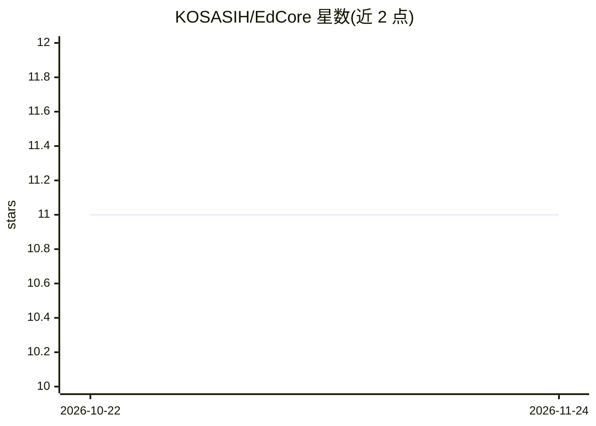

# KOSASIH/EdCore

⭐ — · [GitHub]() · 个人维护

**面向学习者/教育者的 AR 历史教育应用，AI 个性化学习内容**

EdCore 定位为微服务架构的 AR 历史教育应用：用户通过 Web AR 技术以 3D 重建方式探索历史事件、人物与地点，配套测验挑战、虚拟学习小组、历史资源库等功能。AI/ML 用于分析用户偏好与学习模式以个性化推送内容。README 列出 AR.js/A-Frame/WebXR、TensorFlow/scikit-learn/NLTK/SpaCy、Node.js/Angular/React、MongoDB 等技术栈，并给出长达 10 年的路线图（教育者门户、离线模式、AI 评估等均为规划项）。L1 处存在孤立的"MobSF"字样，README 以愿景描述为主，未见可运行的安装与使用说明细节。

## 筛选速览

| 维度 | 判定 | 备注 |
|---|---|---|
| AI 角色 | `ai-enhanced` | 去掉 AI 部分产品仍成立 |
| 许可风险 | `permissive` | — |
| 部署形态 | `self-host` | docker 或自建部署 |
| 模型依赖 | — | README 未给出锁定关系 |
| 硬件要求 | — | 无带数字的原话,不猜 |
| 安装摩擦 | `low` | 无编译、无系统依赖或容器化 |
| 成熟度 | — | 结构信号不足 |

## 能力要点

- 基于 AR.js/A-Frame/WebXR 的 Web 端 AR 历史场景呈现
- AI 算法分析用户偏好与学习模式以个性化内容
- 测验挑战、虚拟学习小组与历史资源库
- 微服务架构，规划 Docker/Kubernetes 部署

## 适用场景

- 学生以沉浸式 AR 方式学习历史事件与人物
- 教育者组织协作式历史课堂讨论
- 历史资源匮乏地区的远程历史教育

## 场景标签

`推荐系统` · 领域:学习与行业

## 证据(README 行号)

> L13: EdCore redefines history education by blending cutting-edge Augmented Reality technology with AI-driven personaliza
> L19: - **Personalized Learning:** AI algorithms analyze user preferences and learning patterns to deliver tailored conte
> L61:  - TensorFlow: An open-source machine learning framework for building AI models.

## 星数曲线

2026-10-22 11 → 2026-11-24 11（+0）

---
*卡片 v1 · prompt 1.4 · 生成 2026-11-19 · 置信度 low · 依据 README sha `44143c08fece` · [字段定义](../../DATASET.md)*
