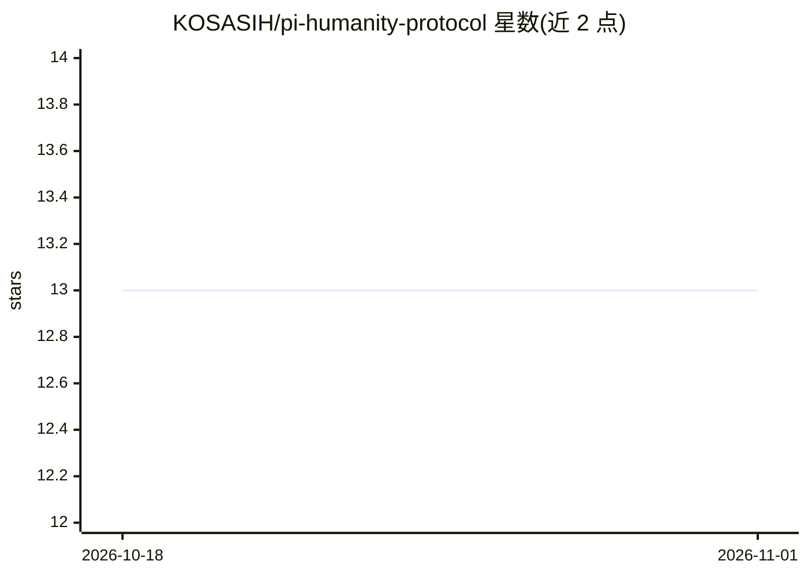

# KOSASIH/pi-humanity-protocol

⭐ 13 · TypeScript · MIT · 推送 2026-10-03 · [GitHub](https://github.com/KOSASIH/pi-humanity-protocol) · [官网](https://pi-humanity-protocol.vercel.app) · 个人维护

**面向 AI 公司的人类众包 API：租用 Pi 网络 KYC 认证用户做人审**

构建在 Pi Network 区块链之上的服务，宣称将 Pi 的 KYC 认证用户池封装为 API，供 AI 公司按需调用（示例端点 /api/rent-humans），获取真人执行模型审计、Human-in-the-Loop 等任务，定位为 EU AI Act 第 14 条合规层。README 以商业宣传与募资材料为主（含 pitch deck 下载、Vercel 部署、Pi 测试网），技术细节多为愿景描述，代码部分未在可见内容中展开。MIT 许可。

## 筛选速览

| 维度 | 判定 | 备注 |
|---|---|---|
| AI 角色 | `ai-ecosystem` | LLM/agent 周边工具 |
| 许可风险 | `permissive` | MIT |
| 部署形态 | `None` |  |
| 模型依赖 | — | README 未给出锁定关系 |
| 硬件要求 | — | 无带数字的原话,不猜 |
| 安装摩擦 | `low` | 无编译、无系统依赖或容器化 |
| 成熟度 | — | 结构信号不足 |

## 能力要点

- 提供 POST /api/rent-humans 形式的 API 示例，按任务类型与人数调用人类审核员
- 基于 Pi Network KYC 认证用户池（宣称 60M+）
- 定位为 EU AI Act Article 14 Human-in-the-Loop 合规层

## 适用场景

- AI 公司为满足监管要求租用真人做模型审计
- 替代机器人评测、获取真人 Human-in-the-Loop 反馈
- Pi Network 生态内寻找众包任务的用户

## 场景标签

 · 领域:AI 基础设施/人类反馈服务

## 证据(README 行号)

> L28: Any AI company can call our API:
> L30: POST /api/rent-humans

## 星数曲线

2026-10-18 13 → 2026-11-01 13（+0）

---
*卡片 v1 · prompt 1.4 · 生成 2026-10-31 · 置信度 mid · 依据 README sha `9718cddd1640` · [字段定义](../../DATASET.md)*
