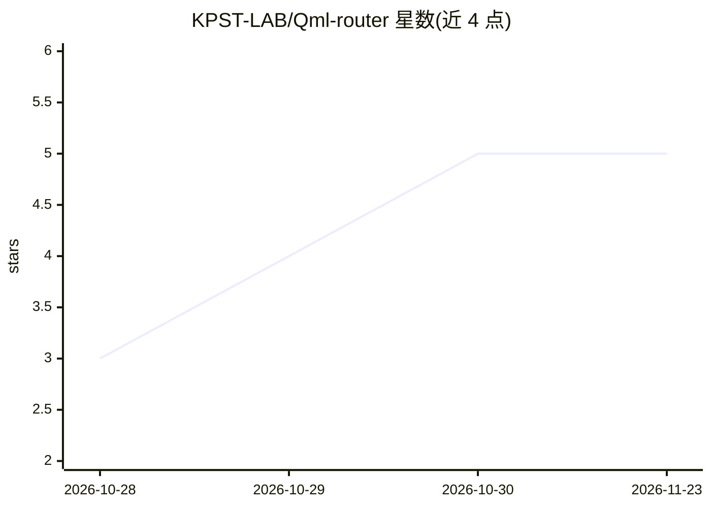

# KPST-LAB/Qml-router

⭐ 5 · Python · AGPL-3.0 · 推送 2026-10-29 · [GitHub](https://github.com/KPST-LAB/Qml-router) · 组织维护

**面向边缘与本地部署的 LLM 持久 KV cache 会话层**

qml-router 是附加在现有推理引擎（llama.cpp、vLLM、SGLang）之外的持久 KV cache 会话层：会话状态以 token 日志为规范记录保存在引擎外部，重连时加载已存 KV 而非重新计算，超出上下文窗口的整轮历史无损归档（TAWT），后续按需经 BM25 索引与置信门控注入（RIG），并支持跨引擎续接会话。面向在边缘设备与本地硬件上运行 LLM 服务的场景，仓库含源码、基准程序与论文实验产物，自带引擎 qml-engine 稍后发布。

## 筛选速览

| 维度 | 判定 | 备注 |
|---|---|---|
| AI 角色 | `ai-ecosystem` | LLM/agent 周边工具 |
| 许可风险 | `dual` | AGPL-3.0 |
| 部署形态 | `library` | 以包/库形式分发 |
| 模型依赖 | local-ok | 支持本地模型 |
| 硬件要求 | — | 无带数字的原话,不猜 |
| 安装摩擦 | `high` | 编译与系统依赖俱全 |
| 成熟度 | `idea` | |

## 能力要点

- 重连恢复 KV cache 而非重算，RTX 4090 上 32K token 恢复 0.66 s
- TAWT 整轮归档 + RIG（SQLite FTS5 BM25 检索与注入门控）实现无损长对话
- 跨引擎会话续接（共享 tokenizer 时回放 token 日志）
- AGPL-3.0 与商业许可并行

## 适用场景

- 边缘设备（如 Jetson）上部署 LLM 服务并复用会话缓存
- 长对话会话在进程重启或引擎切换后继续
- 多用户并发重连场景下降低恢复延迟

## 场景标签

`推理引擎` · 领域:训练与推理

## 证据(README 行号)

> L17:  qml-router is a persistent KV cache session layer for LLM serving on edge and on-premises hardware.
> L53: |What it is|A layer attached to existing engines|An LLM inference engine of its own|
> L92:  llama.cpp, vLLM and SGLang with qml-router attached, saving to and restoring from the qml-router persistence tier 

## 星数曲线

2026-10-28 3 → 2026-11-23 5（+2）

---
*卡片 v1 · prompt 1.4 · 生成 2026-11-21 · 置信度 high · 依据 README sha `d1d3396d5743` · [字段定义](../../DATASET.md)*
