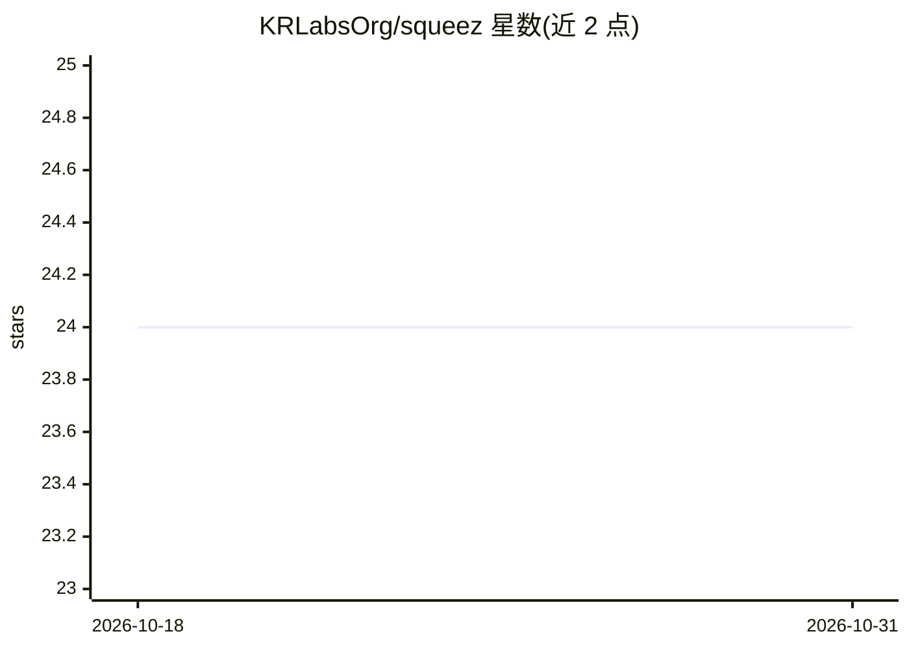

# KRLabsOrg/squeez

⭐ 24 · Python · Apache-2.0 · 推送 2026-04-27 · [GitHub](https://github.com/KRLabsOrg/squeez) · [官网](https://krlabsorg.github.io/squeez) · 组织维护

**给 LLM 编码代理的工具输出剪枝器：只留相关行**

面向 LLM 编码代理的工具输出过滤工具：把 pytest、grep、git log、npm build、kubectl 等命令输出连同任务描述管道输入 squeez，返回仅与任务相关的行，实测压缩率约 92%。提供两种模型：2B 生成式 Qwen 微调版（0.80 F1）与 150M ModernBERT 抽取式替代。使用方式含 CLI 管道、Python 库、vLLM 服务及任意 OpenAI 兼容 API，可写入 CLAUDE.md 供 Claude Code 等 agent 使用。训练数据来自 SWE-bench 工作流的 27 类工具输出。Apache 2.0 许可。

## 筛选速览

| 维度 | 判定 | 备注 |
|---|---|---|
| AI 角色 | `ai-ecosystem` | LLM/agent 周边工具 |
| 许可风险 | `permissive` | Apache-2.0 |
| 部署形态 | `library` | 以包/库形式分发 |
| 模型依赖 | local-ok | 支持本地模型 |
| 硬件要求 | — | 无带数字的原话,不猜 |
| 安装摩擦 | `low` | 无编译、无系统依赖或容器化 |
| 成熟度 | — | 结构信号不足 |

## 能力要点

- 管道式 CLI：任意工具输出 + 任务描述 → 相关行，约 92% 压缩
- 双模型同 CLI：2B 生成式（0.80 F1）与 150M ModernBERT 抽取式
- 支持 vLLM 服务、本地推理与任意 OpenAI 兼容 API 后端
- 在 618 条人工标注样本、27 类工具输出上评测

## 适用场景

- 编码代理中把冗长测试/构建日志压缩后再喂给 LLM
- 配合 Claude Code / Codex CLI 等 agent 减少 token 消耗
- 离线或本地环境下用抽取式模型过滤工具输出

## 场景标签

`编码 Agent` · 领域:编码与开发

## 证据(README 行号)

> L11: - Tool output pruner for LLM coding agents
> L12: - Pipe any tool output (pytest, grep, git log, npm build, kubectl, ...) through squeez with a task description, get

## 星数曲线

2026-10-18 24 → 2026-10-31 24（+0）

---
*卡片 v1 · prompt 1.4 · 生成 2026-10-27 · 置信度 high · 依据 README sha `4e44d4600669` · [字段定义](../../DATASET.md)*
