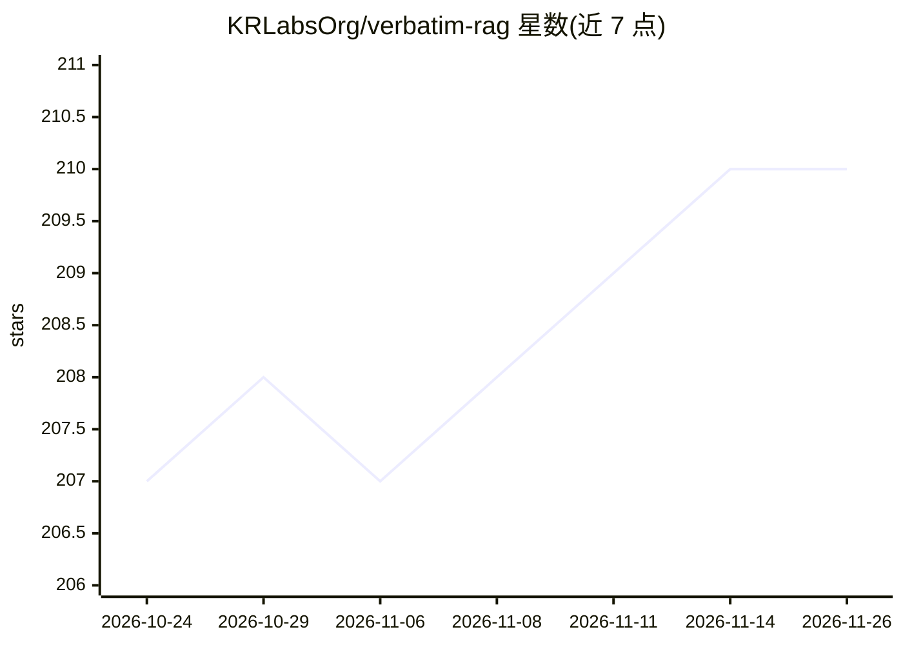

# KRLabsOrg/verbatim-rag

⭐ 210 · Python · MIT · 推送 2026-11-25 · [GitHub](https://github.com/KRLabsOrg/verbatim-rag) · [官网](https://krlabsorg.github.io/verbatim-rag/) · 组织维护

**溯源优先的抽取式 RAG 库：返回带引文的原文片段**

一个 Python 库，实现抽取式 RAG 管线：文档经 docling 转换、chonkie 分块后建立稠密/稀疏向量索引，检索后由 LLM 抽取器或微调的 ModernBERT span 分类器选出原文片段，用模板渲染并附来源引文，减少自由生成环节。提供 verbatim-core 轻量包（仅 openai/pydantic 等依赖）与完整 verbatim-rag 包，附 FastAPI API 与 Vite/React 界面的 Docker Compose 开发栈；本地编码器加静态模板路径可在 CPU 运行，无需生成式 LLM 调用。面向需要答案可溯源的 RAG 开发者。

## 筛选速览

| 维度 | 判定 | 备注 |
|---|---|---|
| AI 角色 | `ai-ecosystem` | LLM/agent 周边工具 |
| 许可风险 | `permissive` | MIT |
| 部署形态 | `self-host` | docker 或自建部署 |
| 模型依赖 | — | README 未给出锁定关系 |
| 硬件要求 | — | 无带数字的原话,不猜 |
| 安装摩擦 | `low` | 无编译、无系统依赖或容器化 |
| 成熟度 | — | 结构信号不足 |

## 能力要点

- 返回来自检索源文本的逐字片段并附引文，默认精确/静态路径保证出处可查
- LLMSpanExtractor（OpenAI 模型）与 ModelSpanExtractor（微调 BERT 类模型）双抽取路径
- 150M 参数 ModernBERT v2 抽取模型支持 8,192 token，多领域语料训练
- SPLADE 加本地编码器加静态渲染配置支持 CPU 执行，无需生成式 API 调用

## 适用场景

- 构建答案必须逐字可溯源的问答系统
- 为 RAG 应用提供引文与原文高亮以抑制编造
- 在无 LLM API 的环境用本地编码器模型完成抽取式回答
- 基于 ACL 等学术语料做文献证据抽取

## 场景标签

`RAG` · 领域:知识与检索

## 证据(README 行号)

> L6: Provenance-first extractive RAG: retrieve documents, select answer-relevant
> L7: passages, and return source excerpts with citations instead of freely rewriting
> L160: 1. **Document Processing**: Documents are processed using docling for format conversion and chonkie for chunking
> L165:  - Key passages are extracted verbatim using either LLM-based or fine-tuned span extractors

## 星数曲线

2026-10-24 207 → 2026-11-26 210（+3）

---
*卡片 v1 · prompt 1.4 · 生成 2026-11-25 · 置信度 high · 依据 README sha `3b76e10325d2` · [字段定义](../../DATASET.md)*
