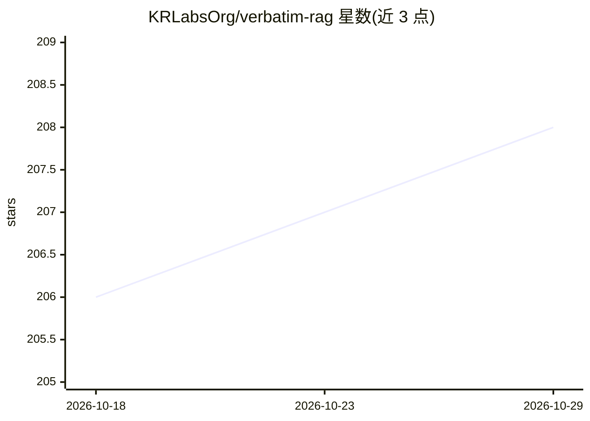

# KRLabsOrg/verbatim-rag

⭐ 208 · Python · MIT · 推送 2026-10-28 · [GitHub](https://github.com/KRLabsOrg/verbatim-rag) · [官网](https://krlabsorg.github.io/verbatim-rag/) · 组织维护

**溯源优先的抽取式 RAG 框架：返回带引用的原文片段**

Python RAG 框架，管道覆盖文档处理（docling+chonkie）、向量索引、片段抽取与模板化回答，输出带来源引用的原文摘录而非自由生成文本。抽取可用 OpenAI 兼容 LLM 或微调 BERT 类模型（默认 150M ModernBERT v2，支持 8192 token）；SPLADE+本地模型配置可在 CPU 上无生成式 LLM API 运行。明确声明这是出处保证而非真实性保证。提供 PyPI 包、轻量 core 子包、Docker Compose 开发栈（FastAPI+React UI+Milvus Lite）及配套数据集与论文。

## 筛选速览

| 维度 | 判定 | 备注 |
|---|---|---|
| AI 角色 | `ai-ecosystem` | LLM/agent 周边工具 |
| 许可风险 | `permissive` | MIT |
| 部署形态 | `self-host` | docker 或自建部署 |
| 模型依赖 | — | README 未给出锁定关系 |
| 硬件要求 | — | 无带数字的原话,不猜 |
| 安装摩擦 | `low` | 无编译、无系统依赖或容器化 |
| 成熟度 | — | 结构信号不足 |

## 能力要点

- 抽取式回答返回带引用的原文片段，template_mode=static 可固定框架文本
- LLMSpanExtractor（OpenAI 兼容 API）与 ModelSpanExtractor（本地 150M ModernBERT）双路径
- SPLADE+本地模型配置支持 CPU 运行，无需生成式 LLM 调用
- Docker Compose 一键运行 FastAPI+React UI+Milvus Lite 开发/演示栈

## 适用场景

- 构建需要可核查出处的问答/引用系统
- 在 CPU 环境离线运行抽取式 RAG
- 评估抽取式 RAG 相比生成式回答的效果（附 ACL-Verbatim 基准）

## 场景标签

`RAG` · 领域:知识与检索

## 证据(README 行号)

> L88: |`verbatim-core`|This repository, `packages/core/`|Reusable question + context → evidence transform, validation, te
> L129: - **VerbatimRAG** (`verbatim_rag/core.py`): Main orchestrator that coordinates document retrieval, span extraction

## 星数曲线

2026-10-18 206 → 2026-10-29 208（+2）

---
*卡片 v1 · prompt 1.4 · 生成 2026-10-22 · 置信度 high · 依据 README sha `860a6b44db4e` · [字段定义](../../DATASET.md)*
