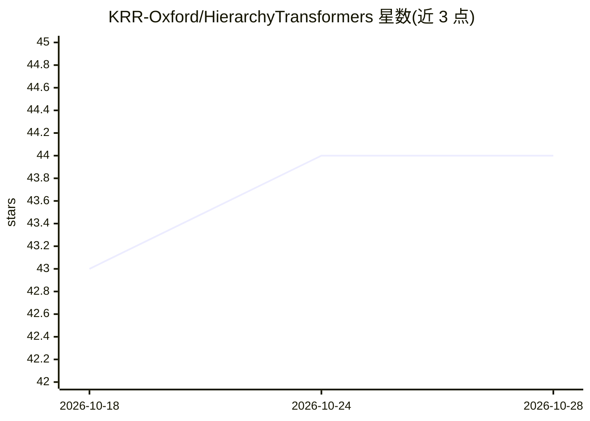

# KRR-Oxford/HierarchyTransformers

⭐ 44 · Python · Apache-2.0 · 推送 2026-01-06 · [GitHub](https://github.com/KRR-Oxford/HierarchyTransformers) · [官网](https://krr-oxford.github.io/HierarchyTransformers/) · 组织维护

**用语言模型在双曲空间编码层次结构的框架（HiT）**

Hierarchy Transformer（HiT）是让基于 transformer 编码器的语言模型在双曲空间学习层次结构的框架：构造 Poincaré 球直接包裹 LM 输出嵌入空间，利用双曲空间指数扩张特性按层级组织实体嵌入。面向需要表示本体/知识层次的研究者与开发者，扩展 sentence-transformers 架构，依赖 deeponto 抽取层次、geoopt 做双曲运算。提供子包含（subsumption）关系预测与自定义训练，模型和数据集发布在 HuggingFace Hub。注意需手动升级 sentence-transformers 到 3.4.0.dev0 以规避 3.3.1 的评估 bug，要求 Python>=3.9。

## 筛选速览

| 维度 | 判定 | 备注 |
|---|---|---|
| AI 角色 | `ai-native` | 本体是模型或模型工具 |
| 许可风险 | `permissive` | Apache-2.0 |
| 部署形态 | `library` | 以包/库形式分发 |
| 模型依赖 | — | README 未给出锁定关系 |
| 硬件要求 | — | 无带数字的原话,不猜 |
| 安装摩擦 | `low` | 无编译、无系统依赖或容器化 |
| 成熟度 | — | 结构信号不足 |

## 能力要点

- Poincaré 球直接包裹 LM 输出嵌入空间的层次编码机制
- 实体嵌入可直接预测 subsumption（子包含）关系
- 模型与数据集发布于 HuggingFace Hub，附训练复现示例脚本
- 扩展 sentence-transformers 架构，依赖 deeponto 与 geoopt

## 适用场景

- 对本体或分类体系中实体间的层次/子包含关系做预测
- 训练自定义层次编码模型并复现已发布模型
- 在知识图谱与语义层次匹配任务中使用 HiT 嵌入

## 场景标签

`知识图谱` `语义搜索` · 领域:知识与检索

## 证据(README 行号)

> L20:  Embedding hierarchies with language models.
> L31: Hierarchy Transformer (HiT) is a framework that enables transformer encoder-based language models (LMs) to learn hi

## 星数曲线

2026-10-18 43 → 2026-10-28 44（+1）

---
*卡片 v1 · prompt 1.4 · 生成 2026-10-25 · 置信度 high · 依据 README sha `5b3d74f9afc9` · [字段定义](../../DATASET.md)*
