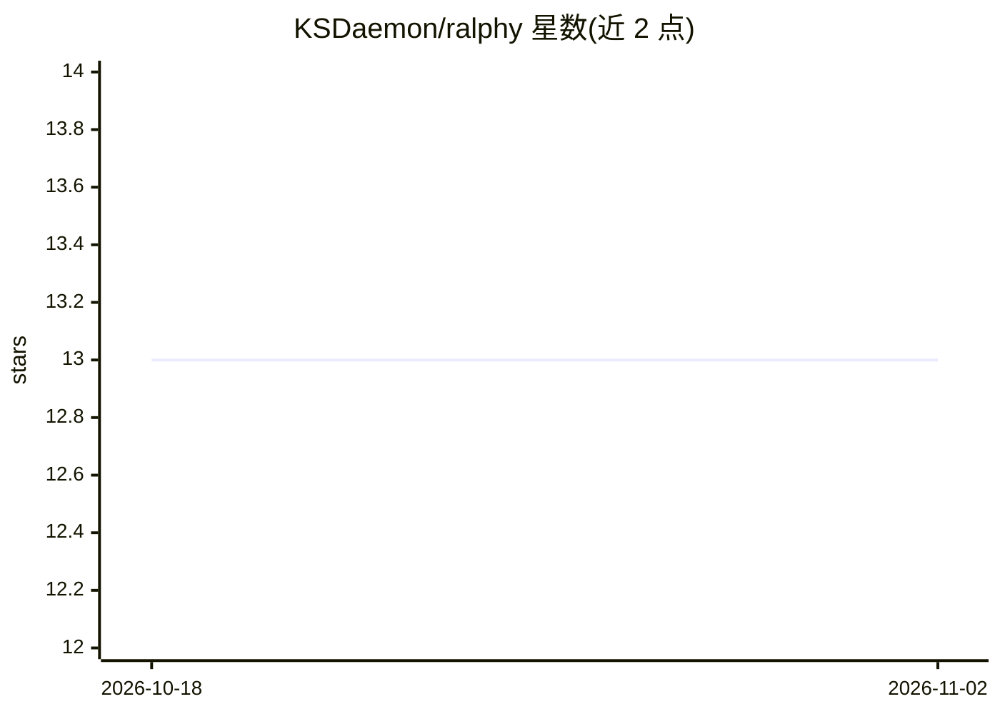

# KSDaemon/ralphy

⭐ 13 · Go · MIT · 推送 2026-09-29 · [GitHub](https://github.com/KSDaemon/ralphy) · 个人维护

**驱动 OpenCode/Claude Code/Amp 的自主编码 agent 循环与终端监控面板**

基于 snarktank/ralph 扩展的自主 AI 编码代理循环：shell 脚本 bin/ralphy 驱动 agent 按用户故事迭代地规划、实现、验证并提交代码，支持分支模式与 git worktree 隔离模式；核心价值在 prompt.md 与 skills/ 提示词。配套 Go 编写的终端 TUI bin/ralphy-admin，可实时查看运行会话日志并暂停/恢复/终止会话。底层 AI 工具可在 OpenCode（默认）、Claude Code、Amp 间切换，模型经 --model/环境变量/settings.toml 三级配置传入。

## 筛选速览

| 维度 | 判定 | 备注 |
|---|---|---|
| AI 角色 | `ai-ecosystem` | LLM/agent 周边工具 |
| 许可风险 | `permissive` | MIT |
| 部署形态 | `None` |  |
| 模型依赖 | — | README 未给出锁定关系 |
| 硬件要求 | — | 无带数字的原话,不猜 |
| 安装摩擦 | `low` | 无编译、无系统依赖或容器化 |
| 成熟度 | — | 结构信号不足 |

## 能力要点

- 一个用户故事一次迭代的自主编码循环（prompt.md + skills 定义流程）
- 默认 git worktree 隔离特性分支，亦支持分支模式
- Go TUI 实时会话监控与暂停/恢复/终止管理
- 支持 OpenCode/Claude Code/Amp 三种底层 AI 工具切换

## 适用场景

- 让 AI 编码代理在隔离的 worktree 中自主完成用户故事
- 同时监控多个 agent 会话的日志与进度
- 在偏好的编码工具与模型组合上跑自主循环

## 场景标签

`编码 Agent` · 领域:编码与开发

## 证据(README 行号)

> L17: 1. **`bin/ralphy`** — a self-contained shell script that drives the agent loop. Run `ralphy help` to see usage. Sup
> L18: (work in the current repo) and **git worktree mode** (default — creates an isolated worktree for the feature branch

## 星数曲线

2026-10-18 13 → 2026-11-02 13（+0）

---
*卡片 v1 · prompt 1.4 · 生成 2026-10-31 · 置信度 high · 依据 README sha `2e32abac3b0b` · [字段定义](../../DATASET.md)*
