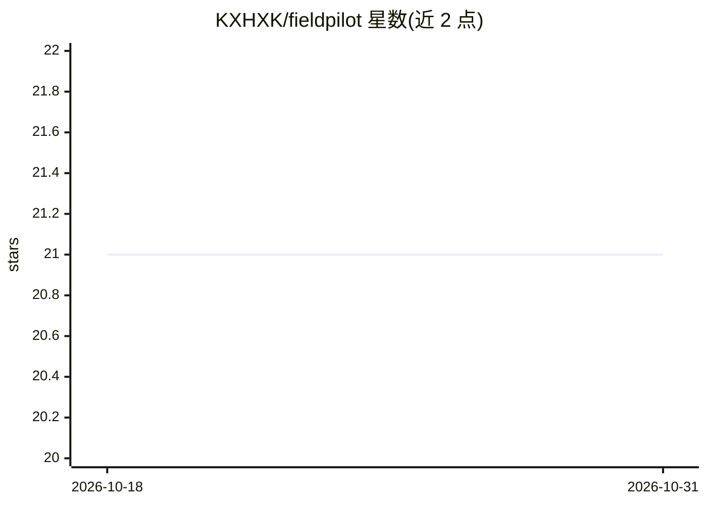

# KXHXK/fieldpilot

⭐ 21 · Python · 推送 2026-08-11 · [GitHub](https://github.com/KXHXK/fieldpilot) · [官网](https://fieldpilot-kxh.netlify.app/) · 个人维护 · 中文 README

**面向跨城外勤人员的任务编排 Agent：把口语需求转为可验证方案**

FieldPilot（v0.6.0）服务经常跨省市出差的外勤人员：通过类型化语义 Agent Harness 把自然语言转换为严格 MissionDraft 草案，缺失信息时返回澄清问题；确定性 Planner（有界 Beam Search，最多三个方案）、Policy Engine 与独立 Verifier 负责时窗、费用与报销合规判断，模型不编造车次、不算成本、不执行购票。接入高德地理编码与路线/餐饮 POI（带降级），支持事件驱动重规划与执行检查点。技术栈为 FastAPI + Pydantic/PydanticAI 后端与 Vue 3 + TypeScript 工作台。限制：公开环境使用 Mock LLM 与 Fixture Provider，真实密钥未复验，高德真实接口不声称可用；Docker Compose 配置已提供但本机尚未验证。

## 筛选速览

| 维度 | 判定 | 备注 |
|---|---|---|
| AI 角色 | `ai-native` | 本体是模型或模型工具 |
| 许可风险 | `none` | — |
| 部署形态 | `desktop` | 安装包/桌面程序 |
| 模型依赖 | — | README 未给出锁定关系 |
| 硬件要求 | — | 无带数字的原话,不猜 |
| 安装摩擦 | `low` | 无编译、无系统依赖或容器化 |
| 成熟度 | `idea` | |

## 能力要点

- 类型化 Agent Harness：自然语言转严格 MissionDraft，缺失时返回三组澄清问题
- 确定性有界 Beam Search 规划 + Policy Engine + 独立 Verifier 三层验证
- 高德 v3/v5 适配（路线、餐饮 POI）具备预算、缓存与逐能力降级
- 事件驱动重规划与执行检查点，保留已执行前缀、后缀重算

## 适用场景

- 跨城多任务出差时生成可比较的交通、住宿与日程方案
- 按公司报销规则核算餐补、住宿与交通费用
- 任务改期或交通中断后触发重规划并查看方案差异
- 检查每个方案的合规判定与政策快照来源

## 场景标签

`工作流自动化` · 领域:效率与自动化

## 证据(README 行号)

> L3: FieldPilot 面向经常跨省市出差的外勤人员，把口语描述中的地点、任务时间窗、紧密程度、交通偏好和公司报销规则转换为可验证、可比较、可动态重规划的执行方案。
> L7: 当前仓库发布版本是 `0.6.0`。类型化语义 Agent Harness 负责把自然语言安全转换为严格 MissionDraft，并治理模型契约、调用预算、确定性后置校验、幂等、审计与 Eval；确定性 Planner、Polic
> L11: 当前实现已完成领域持久化、有限搜索规划、高德路线与餐饮适配及降级、Agent 解析与审计、事件驱动重规划、执行检查点、严格后缀重规划、修订差异和 Vue 工作台闭环。项目站与可写工作台部署在 Netlify，Render Dock

## 星数曲线

2026-10-18 21 → 2026-10-31 21（+0）

---
*卡片 v1 · prompt 1.4 · 生成 2026-10-28 · 置信度 high · 依据 README sha `12817394b0dd` · [字段定义](../../DATASET.md)*
