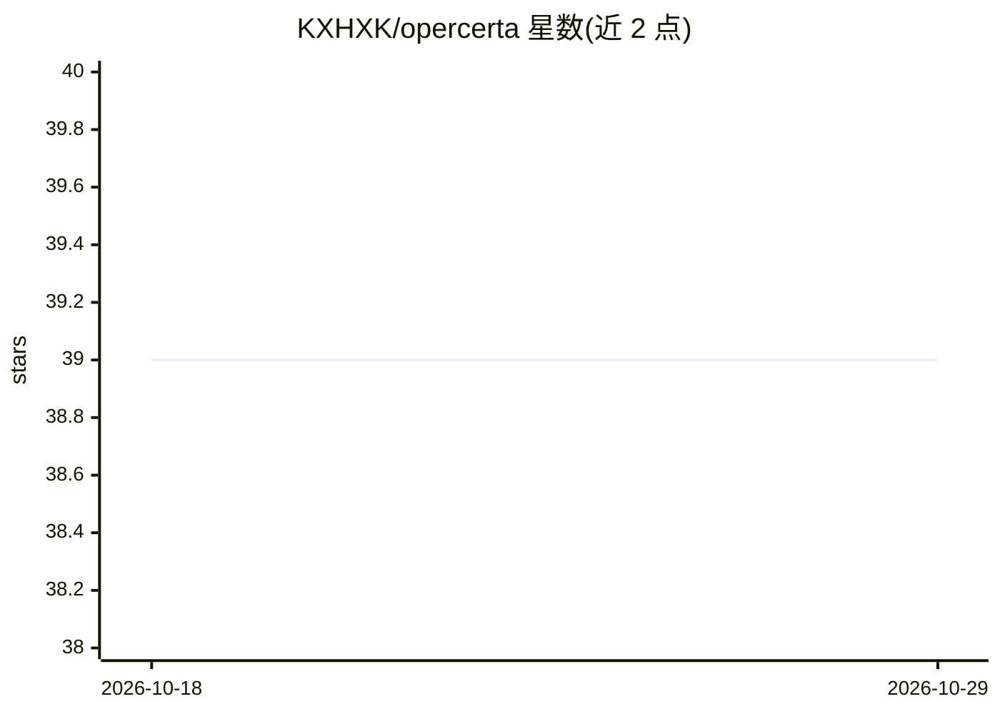

# KXHXK/opercerta

⭐ 39 · Python · Apache-2.0 · 推送 2026-08-12 · [GitHub](https://github.com/KXHXK/opercerta) · [官网](https://opercerta-kxh.netlify.app) · 个人维护 · 中文 README

**可审计的运维 Agent 应用：库存/设备/任务异常的受控处置**

面向运营人员的受控、可审计 Agent 系统：确定性检测器发现库存低于订货点、设备离线报警、任务阻塞等信号，LLM 辅助的 Agent 通过 LangGraph 持久流程与 MCP 类型化工具收集证据并生成建议动作，策略代码判定是否需人工审批，执行前重新获取新鲜证据，PostgreSQL 事务与幂等键保障写入安全。技术栈为 FastAPI + React 控制台 + PostgreSQL/pgvector + Redis。当前版本为静态展示页加本地可复现 MVP，生产身份、公网入口、限流、备份与自动部署未实现。

## 筛选速览

| 维度 | 判定 | 备注 |
|---|---|---|
| AI 角色 | `ai-native` | 本体是模型或模型工具 |
| 许可风险 | `permissive` | Apache-2.0 |
| 部署形态 | `self-host` | docker 或自建部署 |
| 模型依赖 | — | README 未给出锁定关系 |
| 硬件要求 | — | 无带数字的原话,不猜 |
| 安装摩擦 | `low` | 无编译、无系统依赖或容器化 |
| 成熟度 | `idea` | |

## 能力要点

- LLM Agent 收集证据生成建议，策略代码与人工审批决定写入
- 执行前 fresh-fact 重校验与审批时缓存旁路
- PostgreSQL 行锁、幂等键与 LangGraph checkpoint 保障重启恢复
- 默认 Mock 模型模式，无需真实 API key 即可运行

## 适用场景

- 库存低于订货点时生成补货工单（审批后）
- 设备报警时调查并创建维修或隔离工单
- 运营任务阻塞时按恢复策略创建工单或上报
- 审计人员查看完整 trace、审批记录与工单效果

## 场景标签

 · 领域:企业运维/Agent 应用

## 证据(README 行号)

> L31: OperCerta is a controlled, auditable operations agent for inventory shortages,
> L90: |Agent runtime|LangGraph, minimal LangChain Tool Calling|Bounded planning, tool observation loop, interrupt/resume,

## 星数曲线

2026-10-18 39 → 2026-10-29 39（+0）

---
*卡片 v1 · prompt 1.4 · 生成 2026-10-25 · 置信度 high · 依据 README sha `b821f35dbbd1` · [字段定义](../../DATASET.md)*
