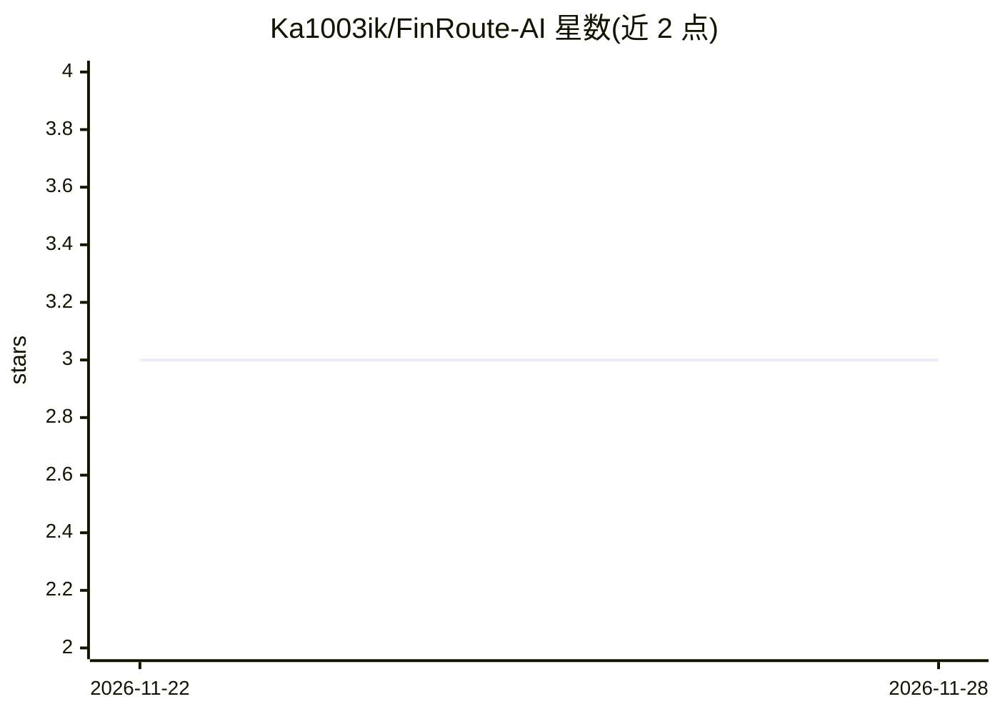

# Ka1003ik/FinRoute-AI

⭐ 3 · Python · 推送 2026-11-20 · [GitHub](https://github.com/Ka1003ik/FinRoute-AI) · 个人维护

**对 CFPB 消费者金融投诉文本做 11 类分类的 NLP 项目**

脚本式 NLP 文本分类项目：读取 CFPB 公共投诉数据，对投诉叙述预测 11 个金融产品类别，用于投诉分拣路由的决策支持。项目对比 7 种 TF-IDF 经典分类器与微调 DistilBERT，采用 StratifiedGroupKFold 防泄漏分组划分，最终以 DistilBERT 为选定模型并在 12,112 条留出测试集上独立评估。交付物为模型、脚本与评估结果，不含 Web 界面、API 或部署。

## 筛选速览

| 维度 | 判定 | 备注 |
|---|---|---|
| AI 角色 | `ai-native` | 本体是模型或模型工具 |
| 许可风险 | `none` | — |
| 部署形态 | `None` |  |
| 模型依赖 | — | README 未给出锁定关系 |
| 硬件要求 | — | 无带数字的原话,不猜 |
| 安装摩擦 | `medium` | 含编译或系统依赖之一 |
| 成熟度 | — | 结构信号不足 |

## 能力要点

- 微调 DistilBERT（distilbert-base-uncased，11 类，512 token）
- 7 种 TF-IDF 经典分类器对比与验证集选择
- StratifiedGroupKFold 分组划分并做独立划分审计
- 留出测试集一次性评估，附混淆矩阵与分类报告

## 适用场景

- 对消费者金融投诉文本按产品类别自动分拣
- 复现防数据泄漏的文本分类实验流程
- 参考经典模型与 transformer 的对比评估方法

## 场景标签

`微调` · 领域:训练与推理

## 证据(README 行号)

> L5: FinRoute AI is a script-based NLP classification project that predicts the financial product category associated wit
> L11: Given a consumer complaint narrative, predict one of 11 CFPB `Product` categories. The intended use is to support c

## 星数曲线

2026-11-22 3 → 2026-11-28 3（+0）

---
*卡片 v1 · prompt 1.4 · 生成 2026-11-22 · 置信度 high · 依据 README sha `8bb9d97f9710` · [字段定义](../../DATASET.md)*
