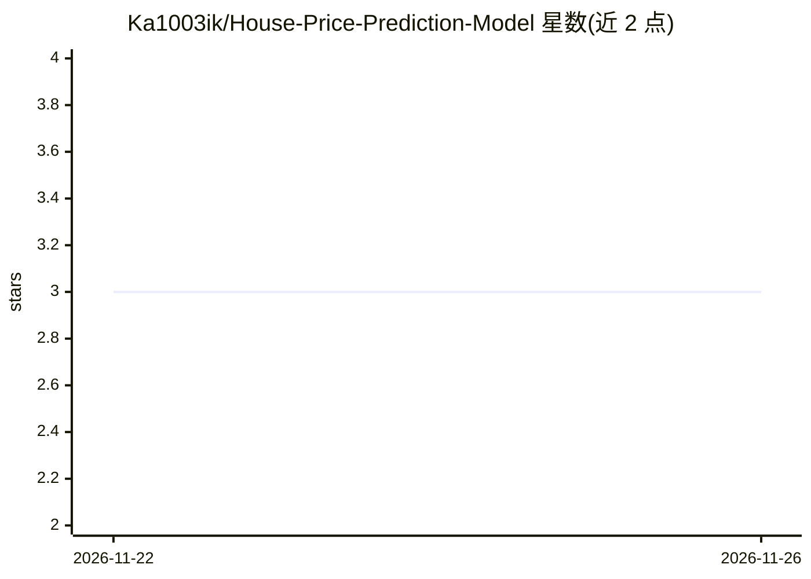

# Ka1003ik/House-Price-Prediction-Model

⭐ 3 · Python · 推送 2026-11-07 · [GitHub](https://github.com/Ka1003ik/House-Price-Prediction-Model) · 个人维护

**基于 Scikit-learn 与 Streamlit 的房价回归预测应用**

端到端机器学习应用：上传 CSV/Excel 数据集后自动检测数值与类别特征、执行预处理，训练并对比线性回归、决策树、随机森林三种回归模型，用 RandomizedSearchCV 做超参数调优，以交叉验证 RMSE、R² 等指标评估，并通过 SHAP 与特征重要性提供可解释性；支持单条与批量房价预测，模型工件按数据集存储。README 载明主数据集为 UCI 房地产估值数据集（414 条记录），项目定位为教学与作品集用途，未声明生产部署。

## 筛选速览

| 维度 | 判定 | 备注 |
|---|---|---|
| AI 角色 | `ai-native` | 本体是模型或模型工具 |
| 许可风险 | `none` | — |
| 部署形态 | `library` | 以包/库形式分发 |
| 模型依赖 | — | README 未给出锁定关系 |
| 硬件要求 | — | 无带数字的原话,不猜 |
| 安装摩擦 | `low` | 无编译、无系统依赖或容器化 |
| 成熟度 | — | 结构信号不足 |

## 能力要点

- 自动特征检测与可配置预处理管道
- 三种回归算法对比与 RandomizedSearchCV 超参数调优
- SHAP 与特征重要性的模型可解释性
- Streamlit 交互界面支持单条与批量预测

## 适用场景

- 上传房产数据集训练回归模型并比较性能
- 对单条房源或批量文件预测房价
- 用 SHAP 查看影响房价的关键特征

## 场景标签

 · 领域:数据科学/预测分析

## 证据(README 行号)

> L3: An end-to-end **Machine Learning application** built with Python and Streamlit to analyze datasets, preprocess featu
> L130: ### 8. Prediction
> L271: This project is developed for educational and portfolio purposes.

## 星数曲线

2026-11-22 3 → 2026-11-26 3（+0）

---
*卡片 v1 · prompt 1.4 · 生成 2026-11-22 · 置信度 high · 依据 README sha `84f97f07cb71` · [字段定义](../../DATASET.md)*
