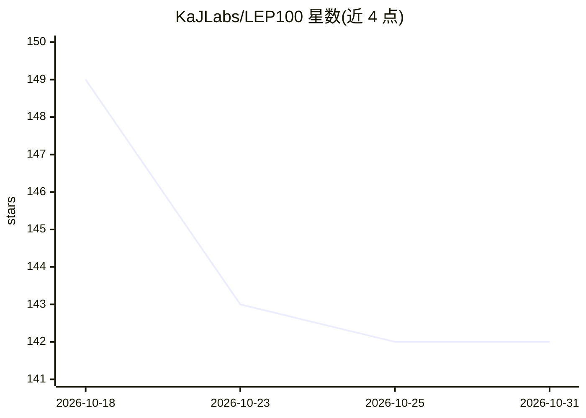

# KaJLabs/LEP100

⭐ 142 · TypeScript · NOASSERTION · 推送 2026-03-25 · [GitHub](https://github.com/KaJLabs/LEP100) · [官网](https://lep100.ai) · 组织维护

**Lithosphere 区块链的 LEP100 智能合约与代币标准规范套件**

由 KaJ Labs 维护的区块链标准提案仓库：定义 14 项 LEP100 规范（Lithic 核心规范、AI 服务提供者标准、zk 可验证 AI 执行扩展、NFT/多代币/版税/跨链桥接口、隐私保护账户链接等），面向 Lithosphere 网络的智能合约开发者。仓库含 RFC 式规范文档、Lithic 参考模块、一致性测试与可选 Rust 工作区，并给出以 Lithic CLI、Solidity/Hardhat 或 Litho Finance 无代码界面三种途径部署 LEP100 代币的步骤，测试网为 Makalu。

## 筛选速览

| 维度 | 判定 | 备注 |
|---|---|---|
| AI 角色 | `ai-ecosystem` | LLM/agent 周边工具 |
| 许可风险 | `none` | NOASSERTION |
| 部署形态 | `library` | 以包/库形式分发 |
| 模型依赖 | — | README 未给出锁定关系 |
| 硬件要求 | — | 无带数字的原话,不猜 |
| 安装摩擦 | `medium` | 含编译或系统依赖之一 |
| 成熟度 | — | 结构信号不足 |

## 能力要点

- 14 项规范覆盖 AI 执行、资产 NFT、版税、跨链桥与隐私账户链接
- 定义 LEP100 合规判定：ABI/事件/错误码/一致性套件/确定性状态转移
- 三种代币部署途径：Lithic CLI、Solidity (EVM/Hardhat)、Litho Finance 无代码 UI
- 支持 Cosmos 与 EVM 双体系（EVM Chain ID 700777）

## 适用场景

- 在 Lithosphere 网络上按 LEP100 标准实现与部署代币/合约
- 查阅 AI 服务提供者与 zk 可验证 AI 执行的链上标准
- 用 Hardhat 或 Lithic CLI 在 Makalu 测试网验证合约

## 场景标签

 · 领域:区块链/Web3 基础设施

## 证据(README 行号)

> L20: - **AI-native execution** (typed services, async fulfillments, receipts, optional zk verification)
> L33: |**LEP100-2**|AI Service Provider Standard|

## 星数曲线

2026-10-18 149 → 2026-10-31 142（-7）

---
*卡片 v1 · prompt 1.4 · 生成 2026-10-22 · 置信度 low · 依据 README sha `726229590f41` · [字段定义](../../DATASET.md)*
