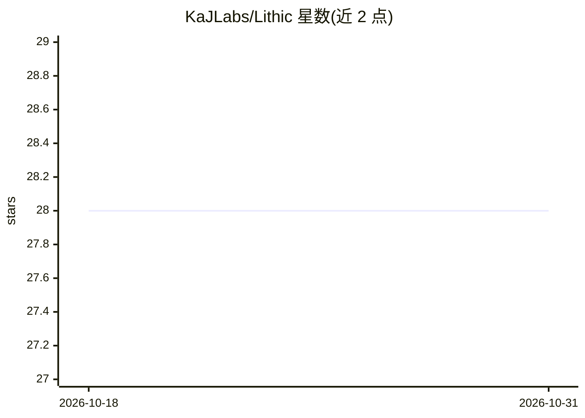

# KaJLabs/Lithic

⭐ 28 · Rust · 推送 2026-09-21 · [GitHub](https://github.com/KaJLabs/Lithic) · [官网](https://lithic.at) · 组织维护

**面向 Lithosphere 链上 AI 应用与 agent 的智能合约编程语言**

Lithic 是 Lithosphere 生态的原生智能合约编程语言，编译目标为 LithoVM（lithc 编译器另提供 EVM 后端），面向在链上部署 AI 原生应用与 agent 的开发者。语言层面提供 ai.service/ai.request/ai.fulfill 异步工作流、类型化 AI 服务声明、单次调用成本上限、按用户预算、能力权限模型与密码学溯源回执，并可选 zk 可验证 AI 执行。附带 LSCL 安全参考模块（AgentWallet、ToolRouter 等）与 LEP100 规范。README 声明同步调用、集合存储与 LEP100-15 执行仍在开发中。

## 筛选速览

| 维度 | 判定 | 备注 |
|---|---|---|
| AI 角色 | `ai-ecosystem` | LLM/agent 周边工具 |
| 许可风险 | `none` | — |
| 部署形态 | `None` |  |
| 模型依赖 | — | README 未给出锁定关系 |
| 硬件要求 | — | 无带数字的原话,不猜 |
| 安装摩擦 | `low` | 无编译、无系统依赖或容器化 |
| 成熟度 | `idea` | |

## 能力要点

- ai.request/ai.fulfill 异步生命周期与 .timeout() 处理
- 成本上限、按用户预算与可编程支出治理
- 能力（capability）权限模型：敏感操作需显式声明
- lithc/lithfmt/lithlint/LSP 与确定性 devnet、AI mock provider 工具链

## 适用场景

- 编写在链上调用 AI 服务的智能合约
- 为 AI 调用设置成本上限与用户预算治理
- 构建带密码学溯源回执的审计型 AI 工作流

## 场景标签

 · 领域:区块链/编程语言

## 证据(README 行号)

> L20: **Lithic** is Lithosphere’s native smart-contract programming language for deploying **AI-native** applications and
> L24: - Typed AI services and async request/fulfill workflows
> L36: - `ai.service` declarations with typed configuration

## 星数曲线

2026-10-18 28 → 2026-10-31 28（+0）

---
*卡片 v1 · prompt 1.4 · 生成 2026-10-26 · 置信度 high · 依据 README sha `893606d3ec2c` · [字段定义](../../DATASET.md)*
