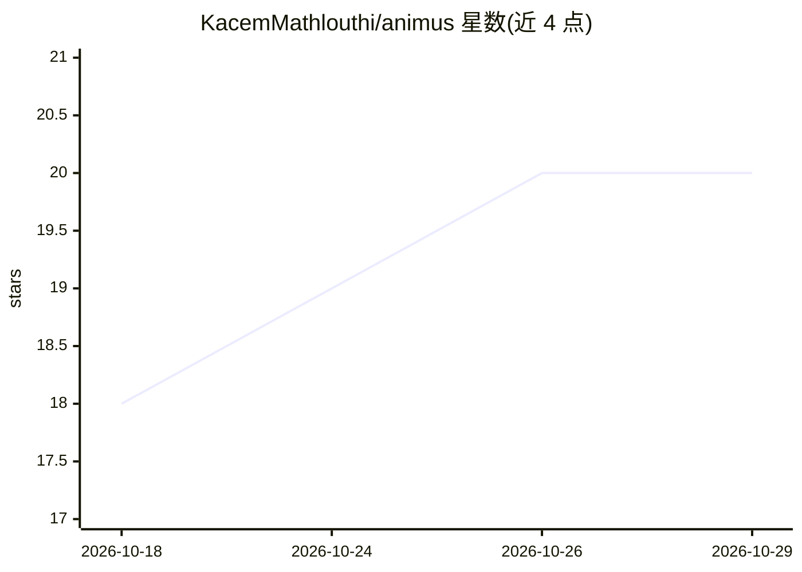

# KacemMathlouthi/animus

⭐ 20 · TypeScript · MIT · 推送 2026-09-20 · [GitHub](https://github.com/KacemMathlouthi/animus) · [官网](https://tryanimus.app) · 个人维护

**对话式 agent 生成有解说的研究型解释视频（Manim）**

animus 是一个面向终端用户的交互式编码 agent：用户描述主题后，agent 通过 web 搜索研究事实、提出分镜计划供确认，在持久云沙箱（Daytona）中编写并渲染 Manim 动画，读取自身报错并修复直至渲染成功；解说由 ElevenLabs 在渲染中合成，动画时长跟随语音。每轮对话是一个 Vercel AI SDK 工具调用循环，经 SSE 流式推送到浏览器。技术栈为 Bun/Turborepo 单仓库，前端 React 19，后端 Hono，模型走 Claude via Amazon Bedrock 并支持 BYOK（Anthropic/OpenAI/Google）。本地运行需 Docker Compose 起 Postgres，配音需 ElevenLabs 付费档。

## 筛选速览

| 维度 | 判定 | 备注 |
|---|---|---|
| AI 角色 | `ai-native` | 本体是模型或模型工具 |
| 许可风险 | `permissive` | MIT |
| 部署形态 | `self-host` | docker 或自建部署 |
| 模型依赖 | locked-api |  |
| 硬件要求 | — | 无带数字的原话,不猜 |
| 安装摩擦 | `low` | 无编译、无系统依赖或容器化 |
| 成熟度 | — | 结构信号不足 |

## 能力要点

- 研究先行：具体数字/日期/引述先做 web 搜索再写入视频
- 云端沙箱中编写、渲染、读报错并自修复 Manim 场景
- 解说经 manim-voiceover + ElevenLabs 渲染期合成，动画时序跟随语音
- 每用户回合为一个可中断的 AI SDK 工具调用循环（SSE 流式）

## 适用场景

- 把任意主题变成有配音的解释动画视频
- 对已生成视频继续对话修改（加场景、换配色、改节奏）后重新渲染
- 发布视频到带品牌页的永久未列出链接或下载 mp4

## 场景标签

`视频生成` · 领域:内容生成

## 证据(README 行号)

> L18: animus is an interactive coding agent for Manim
> L21: - **Describe a topic.** The agent researches it and settles a scene plan with you.
> L52: Each user turn is one AI SDK tool calling loop, streamed to the browser over SSE

## 星数曲线

2026-10-18 18 → 2026-10-29 20（+2）

---
*卡片 v1 · prompt 1.4 · 生成 2026-10-28 · 置信度 high · 依据 README sha `44fbbe56cd02` · [字段定义](../../DATASET.md)*
