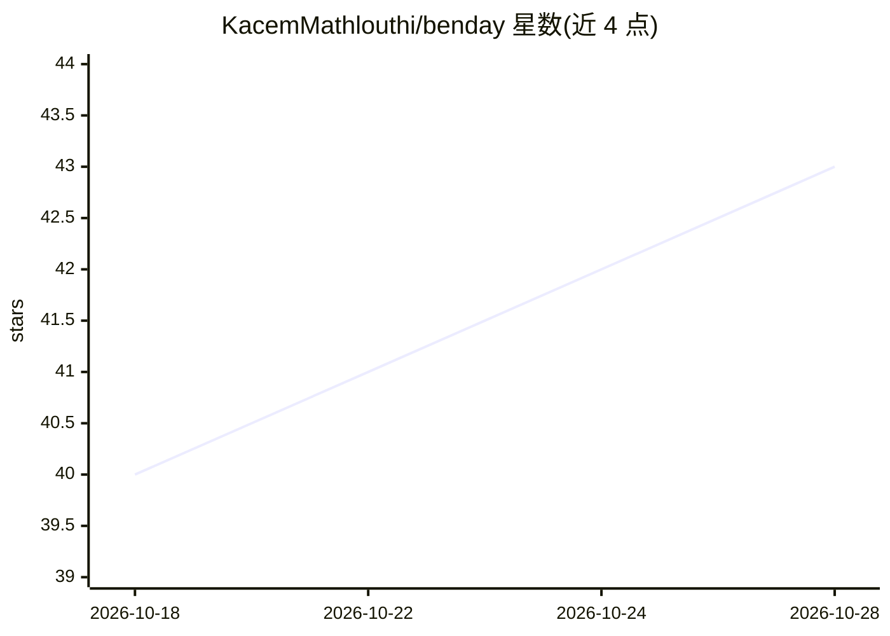

# KacemMathlouthi/benday

⭐ 43 · TypeScript · MIT · 推送 2026-08-30 · [GitHub](https://github.com/KacemMathlouthi/benday) · [官网](https://benday.kacemmathlouthi.dev) · 个人维护

**将 Logo 半调化为动画思考指示器的 React 组件**

通过 shadcn registry 分发的 React UI 原语：读取 Logo 图片，经光栅化、alpha/亮度墨迹分离与欧氏距离变换生成点阵图，再以 21 种预设动画将 Logo 渲染为 thinking/idle/done 状态的思考指示器，供 agent UI 等界面使用。安装后 7 个文件落入项目归用户所有，仅依赖 React，无运行时包依赖。支持构建期预烘焙 dotMap、离屏暂停、reduced motion 与 currentColor 解析。

## 筛选速览

| 维度 | 判定 | 备注 |
|---|---|---|
| AI 角色 | `ai-enhanced` | 去掉 AI 部分产品仍成立 |
| 许可风险 | `permissive` | MIT |
| 部署形态 | `None` |  |
| 模型依赖 | — | README 未给出锁定关系 |
| 硬件要求 | — | 无带数字的原话,不猜 |
| 安装摩擦 | `low` | 无编译、无系统依赖或容器化 |
| 成熟度 | — | 结构信号不足 |

## 能力要点

- Logo 经距离变换生成点阵图，21 种预设动画渲染思考指示器
- thinking/idle/done 状态切换，点阵回弹聚合
- 安装后文件归项目所有，仅依赖 React，无包依赖
- 支持构建期烘焙 dotMap、离屏暂停与 reduced motion

## 适用场景

- 为 agent 聊天界面用自家 Logo 做思考中动画
- React 项目中嵌入可定制的加载指示器
- 自定义预设动画（单点+时钟函数）扩展指示器效果

## 场景标签

 · 领域:前端 UI 组件

## 证据(README 行号)

> L5: **Your logo, halftoned into a thinking indicator.**
> L20: <Benday src="/logo.svg" state={isThinking ? "thinking" : "done"} />;

## 星数曲线

2026-10-18 40 → 2026-10-28 43（+3）

---
*卡片 v1 · prompt 1.4 · 生成 2026-10-25 · 置信度 high · 依据 README sha `28923bdff99f` · [字段定义](../../DATASET.md)*
