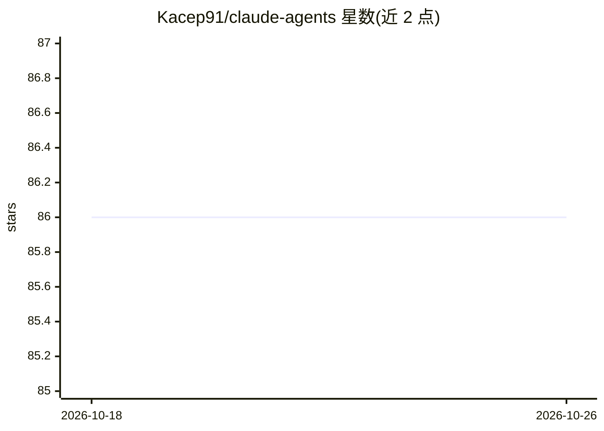

# Kacep91/claude-agents

⭐ 86 · JavaScript · GPL-3.0 · 推送 2025-12-01 · [GitHub](https://github.com/Kacep91/claude-agents) · 个人维护

**面向 Claude Code 的 7 个专用 agent 配置与工作流集合**

个人维护的 Claude Code 子代理配置集合：提供 architect、prd-writer、worker、test-writer-worker、refactor、test-auditor、linus-code-reviewer 共 7 个 agent，分别指定 Sonnet/Opus 模型与用途，遵循 SLON、KISS、Occam's Razor、DRY 原则。附 4 个 Node.js 脚本用于覆盖率分析、测试失败提取与 TypeScript 检查，并文档化统一的六步工作流（规划模式→提示撰写→反向分析→迭代计划→执行监控→上下文管理）。无安装命令，以 GPLv3 许可。

## 筛选速览

| 维度 | 判定 | 备注 |
|---|---|---|
| AI 角色 | `ai-knowledge` | 知识聚合/清单类 |
| 许可风险 | `viral` | GPL-3.0 |
| 部署形态 | `None` |  |
| 模型依赖 | locked-api |  |
| 硬件要求 | — | 无带数字的原话,不猜 |
| 安装摩擦 | `low` | 无编译、无系统依赖或容器化 |
| 成熟度 | — | 结构信号不足 |

## 能力要点

- 7 个指定模型的专用 agent（架构、PRD、实现、测试、重构、审计、代码评审）
- 4 个 Node.js 辅助脚本（lcov 覆盖率解析、测试失败提取、TS 文件/暂存区检查）
- 文档化的六步任务工作流，含上下文低余量时的会话重启策略

## 适用场景

- 为 Claude Code 配置分工明确的子代理角色
- 按既定工作流执行规划-实现-评审的开发任务
- 低上下文剩余时保存计划并重启会话继续任务

## 场景标签

`编码 Agent` `提示工程` · 领域:Agent 开发

## 证据(README 行号)

> L3: Specialized Claude AI agent configurations for software development workflows. Each agent follows SLON, KISS, and Oc
> L14: |Agent|Model|Purpose|When to Use|
> L24: ## Scripts

## 星数曲线

2026-10-18 86 → 2026-10-26 86（+0）

---
*卡片 v1 · prompt 1.4 · 生成 2026-10-24 · 置信度 high · 依据 README sha `20517bd97de2` · [字段定义](../../DATASET.md)*
