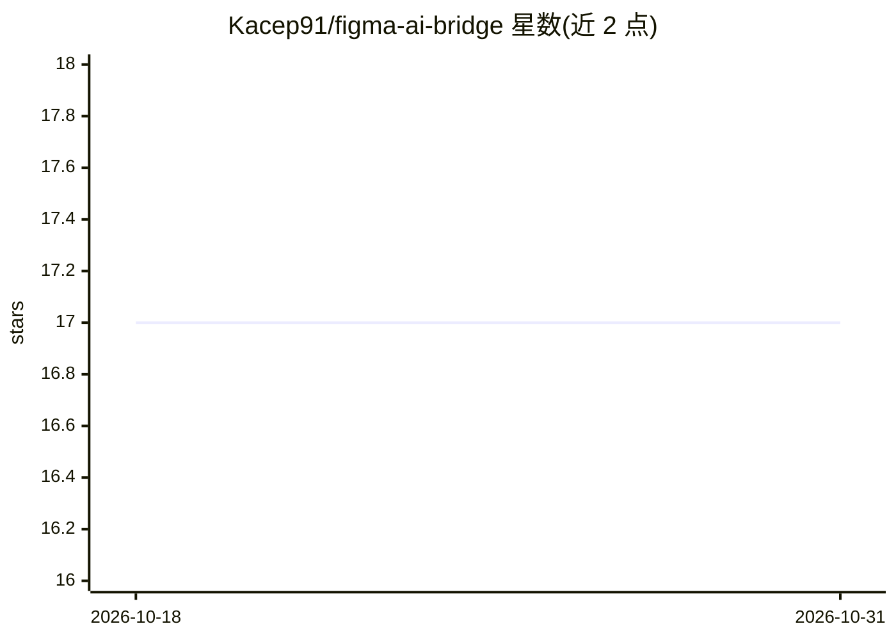

# Kacep91/figma-ai-bridge

⭐ 17 · JavaScript · MIT · 推送 2026-08-11 · [GitHub](https://github.com/Kacep91/figma-ai-bridge) · 个人维护 · 中文 README

**本地 Figma 插件+桥接器：把设计文件导出为 AI 可读的交付包**

由 Figma Desktop 插件与 localhost 本地服务器组成的工具链：插件从打开的 Figma 文件提取预览图、文本、结构、尺寸、样式与画板关联，经本地桥接输出为带 manifest、prompt、design-context.json 等文件的数据包，供 Codex 等 AI agent 通过 SKILL.md 工作流读取、生成视觉描述并补全实现数据。支持 Page Extract / Links Batch / Selection 三种捕获模式，提供 doctor/validate/summary/auto 命令行命令。不调用 Figma API、不使用 Dev Mode MCP 与访问令牌，全部数据仅保存在本地；服务器自身不做图像识别。面向前端开发者与设计交付场景。

## 筛选速览

| 维度 | 判定 | 备注 |
|---|---|---|
| AI 角色 | `ai-ecosystem` | LLM/agent 周边工具 |
| 许可风险 | `permissive` | MIT |
| 部署形态 | `None` |  |
| 模型依赖 | — | README 未给出锁定关系 |
| 硬件要求 | — | 无带数字的原话,不猜 |
| 安装摩擦 | `low` | 无编译、无系统依赖或容器化 |
| 成熟度 | — | 结构信号不足 |

## 能力要点

- 三步导出：插件捕获 → localhost 桥接 → out/ 数据包，无需 Figma API/令牌
- 为 AI agent 设计的分层读取顺序（prompt.md→summary→visual-brief→精确 JSON）
- auto 命令生成 Codex 视觉描述与数据补全任务文件（自身不调用 Codex）
- SKILL.md 定义 agent 主工作流，配套 bundle contract 文档

## 适用场景

- 把 Figma 设计稿导出成小体积数据包交给 AI agent 做前端实现
- 绕过 Figma API 令牌限制，在本地完成设计到 AI 的交付
- 批量按节点链接捕获多个画板并生成结构化清单

## 场景标签

 · 领域:设计工具/开发工具

## 证据(README 行号)

> L17: Figma AI Bridge экспортирует данные из открытого файла Figma Desktop в локальный пакет, который затем читает ИИ-аге
> L30: 2. ИИ-агент (Codex или аналогичный) читает собранный пакет через skill, описывает визуал и дополняет данные для вер
> L137: 2. Then Codex or another AI agent reads the bundle through the skill, writes visual descriptions, and enriches the

## 星数曲线

2026-10-18 17 → 2026-10-31 17（+0）

---
*卡片 v1 · prompt 1.4 · 生成 2026-10-30 · 置信度 high · 依据 README sha `2446a6e1bba3` · [字段定义](../../DATASET.md)*
