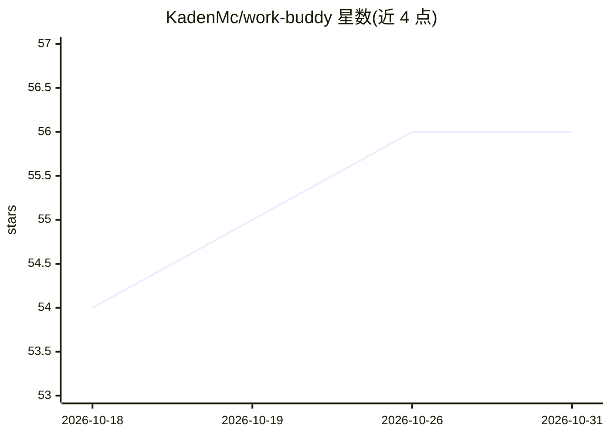

# KadenMc/work-buddy

⭐ 56 · Python · GPL-3.0 · 推送 2026-10-19 · [GitHub](https://github.com/KadenMc/work-buddy) · [官网](http://work-buddy.ai/) · 个人维护

**知识工作者的本地个人 agent 运行时（基于 Claude Code）**

本地优先的个人 agent 运行时，构建于 Claude Code 与 MCP 之上，面向知识工作者：通过本地 MCP 服务器向 Claude Code 暴露 wb_search/wb_run/wb_advance/wb_status 等网关工具，提供工作流编排、跨会话记忆、SQLite 支撑的日志/任务/项目/合同/个人知识库，以及 React 仪表盘与 Telegram 审批通道。工作流例行步骤以普通代码执行，仅在需判断时调用 agent。使用现有 Claude Code 订阅运行，无需单独服务费。以安装包分发（自带约 1GB Python 依赖），当前主要在 Windows 11 开发，Linux/macOS 支持较新；0.x 阶段 API 不稳定，自称 beta。

## 筛选速览

| 维度 | 判定 | 备注 |
|---|---|---|
| AI 角色 | `ai-ecosystem` | LLM/agent 周边工具 |
| 许可风险 | `viral` | GPL-3.0 |
| 部署形态 | `None` |  |
| 模型依赖 | locked-api |  |
| 硬件要求 | — | 无带数字的原话,不猜 |
| 安装摩擦 | `low` | 无编译、无系统依赖或容器化 |
| 成熟度 | `idea` | |

## 能力要点

- 基于 MCP 的四工具网关扩展 Claude Code，工作流编排器支持中断恢复
- SQLite 本地存储：Journal/Tasks/Projects/Contracts/Personal Knowledge 与会话全文检索
- React 仪表盘与 Telegram 构成审批/控制回路，敏感操作需显式批准
- 50+ slash 命令；agent 可通过 /wb-dev 自行开发扩展并提 PR

## 适用场景

- 每天用 /wb-morning 生成简报、优先级与日计划
- 整理 Chrome 标签页、零散速记并归路由到任务
- 跨项目检索所有 agent 会话与决策记录
- 在仪表盘或 Telegram 上审批 agent 的敏感操作

## 场景标签

`AI 助手` `工作流自动化` `知识库管理` · 领域:效率与自动化

## 证据(README 行号)

> L22: **work-buddy** is the AI assistant for knowledge workers — a local-first personal-agent runtime built on Claude Cod
> L71: work-buddy runs a local MCP server that extends Claude Code with a **gateway**: a small set of tools through which 

## 星数曲线

2026-10-18 54 → 2026-10-31 56（+2）

---
*卡片 v1 · prompt 1.4 · 生成 2026-10-24 · 置信度 high · 依据 README sha `d7f4e595dcd6` · [字段定义](../../DATASET.md)*
