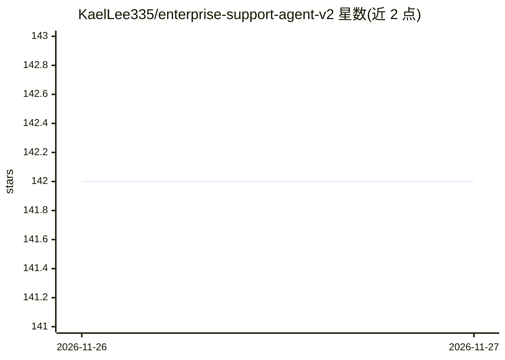

# KaelLee335/enterprise-support-agent-v2

⭐ 142 · Python · MIT · 推送 2026-11-25 · [GitHub](https://github.com/KaelLee335/enterprise-support-agent-v2) · 个人维护 · 中文 README

**电商售后场景的多租户智能客服 Agent 全栈演示**

将订单查询、政策 RAG 问答、模拟物流查询与退款人工审批组织为带租户隔离的工作流：FastAPI 提供接口，LangGraph 做路由编排，Chroma 做政策检索并在回答中展示证据来源，Langfuse（默认关闭）记录请求、节点与模型调用。含 Vue 3 工作台、七种演示身份令牌、pytest 157 项测试与评估脚本。所有订单、身份、物流均为虚构数据，退款只更新演示状态不调用真实平台；当前不支持 token 流式输出。

## 筛选速览

| 维度 | 判定 | 备注 |
|---|---|---|
| AI 角色 | `ai-native` | 本体是模型或模型工具 |
| 许可风险 | `permissive` | MIT |
| 部署形态 | `self-host` | docker 或自建部署 |
| 模型依赖 | — | README 未给出锁定关系 |
| 硬件要求 | — | 无带数字的原话,不猜 |
| 安装摩擦 | `low` | 无编译、无系统依赖或容器化 |
| 成熟度 | — | 结构信号不足 |

## 能力要点

- LangGraph 路由 + Chroma Top-K 检索，回答附带政策来源与证据
- 人工审批流程：请求暂停于 checkpoint，仅分配的审批人可处理
- 角色与租户隔离，通过数据库查询和 API 双重校验
- Langfuse 可观测性与评估脚本（路由、安全性、RAG 回归）

## 适用场景

- 搭建带权限边界的企业客服 Agent 学习参考
- 体验人工审批介入的退款申请流程
- 复现含可观测性与评估口径的 Agent 工程实践

## 场景标签

`RAG` `聊天机器人` · 领域:对话与助手

## 证据(README 行号)

> L3: 一个面向电商售后场景的 Python 全栈 Agent 工程演示：把订单查询、政策问答、物流查询与人工审批组织成可观察、可评估、带租户边界的工作流。项目将 Dify 原型迁移为代码实现，覆盖 FastAPI、SQLite、LangC
> L7: - **业务流程**：身份与租户校验 → FastAPI → LangGraph 路由 → 订单查询、政策 RAG、模拟物流或审批流程。
> L20: |智能客服|订单查询、政策问答、引用证据和节点执行事件|

## 星数曲线

2026-11-26 142 → 2026-11-27 142（+0）

---
*卡片 v1 · prompt 1.4 · 生成 2026-11-26 · 置信度 high · 依据 README sha `7885764611d6` · [字段定义](../../DATASET.md)*
