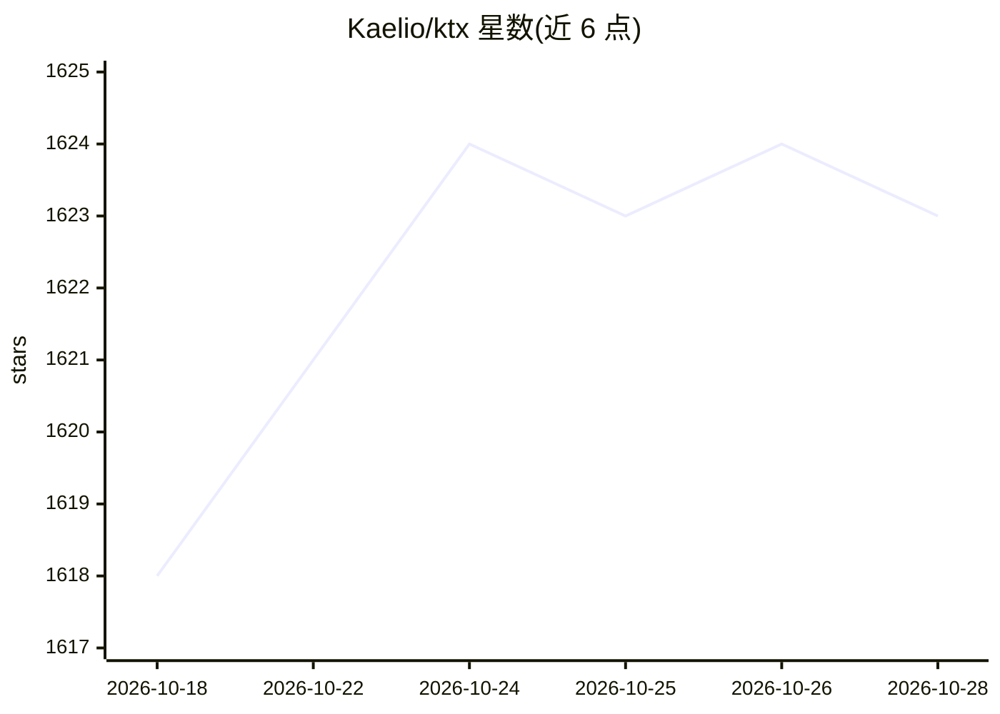

# Kaelio/ktx

⭐ 1,624 · TypeScript · Apache-2.0 · 推送 2026-10-22 · [GitHub](https://github.com/Kaelio/ktx) · [官网](https://docs.kaelio.com/ktx) · 组织维护

**给数据/分析 AI agent 的仓库上下文层：让 agent 按认可口径查数**

Kaelio 维护的本地上下文层工具：通过连接器摄取 SQL 仓库、dbt、Looker、Metabase、Notion 等来源，构建 wiki Markdown 与语义层 YAML，检测可 join 列、合并指标定义并标记跨源矛盾；agent 通过 MCP 或 CLI 检索这些上下文，生成只读 SQL 查询仓库。面向有 SQL 数仓并使用 Claude Code、Codex 等编码 agent 的分析与数据团队，需自备 LLM API key 或本地 agent 登录，npm 全局安装，连接只读、无托管服务。

## 筛选速览

| 维度 | 判定 | 备注 |
|---|---|---|
| AI 角色 | `ai-ecosystem` | LLM/agent 周边工具 |
| 许可风险 | `permissive` | Apache-2.0 |
| 部署形态 | `library` | 以包/库形式分发 |
| 模型依赖 | locked-api |  |
| 硬件要求 | — | 无带数字的原话,不猜 |
| 安装摩擦 | `low` | 无编译、无系统依赖或容器化 |
| 成熟度 | — | 结构信号不足 |

## 能力要点

- 摄取数据库、BI 工具、建模代码与文档，构建 wiki 与语义层
- join 图解析 chasm/fan trap，沉淀可复用认可指标定义
- CLI + MCP 工具提供 wiki 与语义层的全文+语义检索
- 支持 PostgreSQL、Snowflake、BigQuery、ClickHouse 等 10 种数据源，连接只读

## 适用场景

- 让 Claude Code/Codex 等 agent 按认可的指标定义查询数仓
- 把散落在 dbt、Looker、Notion、团队 wiki 的业务知识汇成统一检索面
- 标记跨数据源定义矛盾供人工审核

## 场景标签

`数据分析` `知识库管理` · 领域:效率与自动化

## 证据(README 行号)

> L35:  Serving: an agent queries ktx through MCP, which searches the wiki and semantic layer, returns approved metrics, a
> L57: - **Serves agents at execution.** Exposes CLI and MCP tools with combined

## 星数曲线

2026-10-18 1,618 → 2026-10-28 1,623（+5）

---
*卡片 v1 · prompt 1.4 · 生成 2026-10-21 · 置信度 high · 依据 README sha `4c9ff3995927` · [字段定义](../../DATASET.md)*
