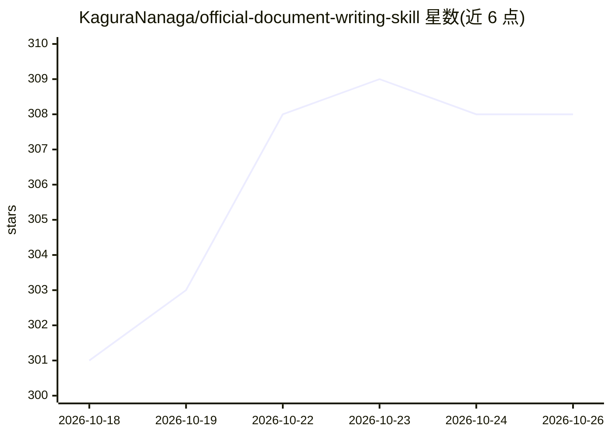

# KaguraNanaga/official-document-writing-skill

⭐ 308 · MIT · 推送 2026-01-26 · [GitHub](https://github.com/KaguraNanaga/official-document-writing-skill) · 个人维护 · 中文 README

**面向公文写作者的中文公文写作 AI Skill 工具包**

遵循 GB/T 9704-2012《党政机关公文格式》国家标准的 Skill 工具包，为中文党政机关公文写作提供格式规范说明、6 类公文标准模板与 30+ 实例、写作技巧指南（含 80+ 常见错误修正、50+ 规范用语）以及 100+ 项质量检查清单。基于 Claude Code 官方 skill-creator 框架优化，采用渐进式披露设计（SKILL.md 核心文件 + references/checklists 分层加载）。目标用户为党政机关文秘人员、企事业单位行政人员、公文写作学习者与审校人员。

## 筛选速览

| 维度 | 判定 | 备注 |
|---|---|---|
| AI 角色 | `ai-knowledge` | 知识聚合/清单类 |
| 许可风险 | `permissive` | MIT |
| 部署形态 | `None` |  |
| 模型依赖 | — | README 未给出锁定关系 |
| 硬件要求 | — | 无带数字的原话,不猜 |
| 安装摩擦 | `low` | 无编译、无系统依赖或容器化 |
| 成熟度 | — | 结构信号不足 |

## 能力要点

- 基于 GB/T 9704-2012 的完整格式规范与排版规则
- 6 类公文标准模板与 30+ 实例
- 100+ 项质量检查清单（格式/内容/语言/逻辑/细节）
- SKILL.md + references + checklists 渐进式披露结构

## 适用场景

- 按模板从零起草请示、通知、函等公文
- 用质量清单逐项检查草稿的格式合规性
- 系统学习公文写作规范与常用表述

## 场景标签

`AI 写作` `提示工程` · 领域:Agent 开发

## 证据(README 行号)

> L5: This is a professional Skill toolkit for writing Chinese Party and government official documents (公文). It strictly f
> L7: This project is optimized based on Claude Code’s official **skill-creator** framework and adopts the **progressive d
> L14: - **Standard Reference**: GB/T 9704-2012 _Format of Official Documents of Party and Government Organs_

## 星数曲线

2026-10-18 301 → 2026-10-26 308（+7）

---
*卡片 v1 · prompt 1.4 · 生成 2026-10-21 · 置信度 high · 依据 README sha `f9ca58cc1f18` · [字段定义](../../DATASET.md)*
