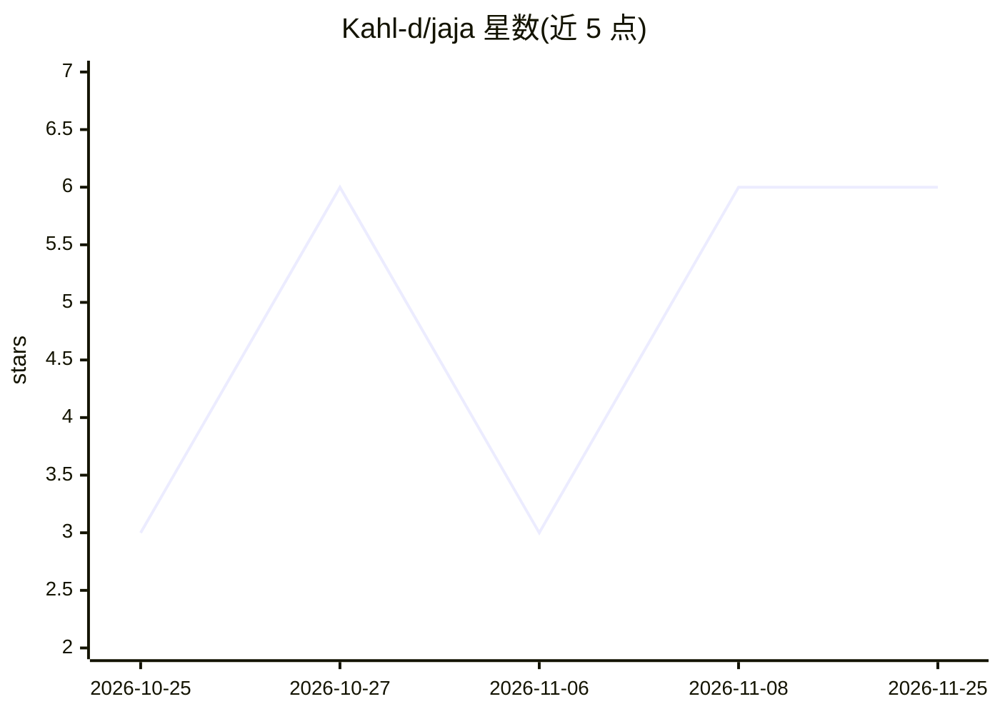

# Kahl-d/jaja

⭐ 6 · Python · MIT · 推送 2026-10-23 · [GitHub](https://github.com/Kahl-d/jaja) · 个人维护

**基于 Claude Code 的求职代理团队插件：找岗位、写材料、外发需人工批准**

以 Claude Code 插件形式交付的求职流水线：30 个角色 agent 分属七个小队（Find/Judge/Write/Reach out/Track/Prepare/Run the day），配 52 个技能、8 条 lane、16 个默认关闭的例程、9 个守卫钩子和一个 24 工具 MCP 服务器。关键机制：每条外发动作需签署批准文件（T0-T4 自治分级）、每个简历/信件声明必须引用证据 id、脚本负责计数与校验而模型负责评判与起草。面向已使用 Claude Code 的技术求职者。目前仅测试 Claude Code，Codex 适配器未端到端运行，仅支持 macOS 与 Linux。

## 筛选速览

| 维度 | 判定 | 备注 |
|---|---|---|
| AI 角色 | `ai-native` | 本体是模型或模型工具 |
| 许可风险 | `permissive` | MIT |
| 部署形态 | `library` | 以包/库形式分发 |
| 模型依赖 | locked-api |  |
| 硬件要求 | — | 无带数字的原话,不猜 |
| 安装摩擦 | `low` | 无编译、无系统依赖或容器化 |
| 成熟度 | `idea` | |

## 能力要点

- 30 个角色 agent 带 T0-T4 自治分级、模型、预算与 KPI 的角色卡
- 外发前强制人工批准；每条声明必须引用用户证据 id
- 24 工具 MCP 服务器与 52 个 /jaja:<name> 技能
- 5,192 个测试在演示数据上通过，数据目录与代码仓库隔离

## 适用场景

- 为技术岗位的长周期求职建立结构化可审计的流水线
- 从自己的证据库生成并校验定制简历与外联消息
- 追踪申请事件、邮件分类与签证/工作许可时限

## 场景标签

`编码 Agent` `多智能体` `工作流自动化` · 领域:Agent 开发

## 证据(README 行号)

> L5:  A job-search agency for Claude Code: a team of agents that finds roles and people, gates and ranks them,
> L19: Scripts count, gate and check; models judge and draft; you decide and sign. Your profile, contacts, jobs and writin
> L185: For engineers and other technical job seekers who already use Claude Code and want a structured, auditable pipelin

## 星数曲线

2026-10-25 3 → 2026-11-25 6（+3）

---
*卡片 v1 · prompt 1.4 · 生成 2026-11-20 · 置信度 mid · 依据 README sha `80a0688561c2` · [字段定义](../../DATASET.md)*
