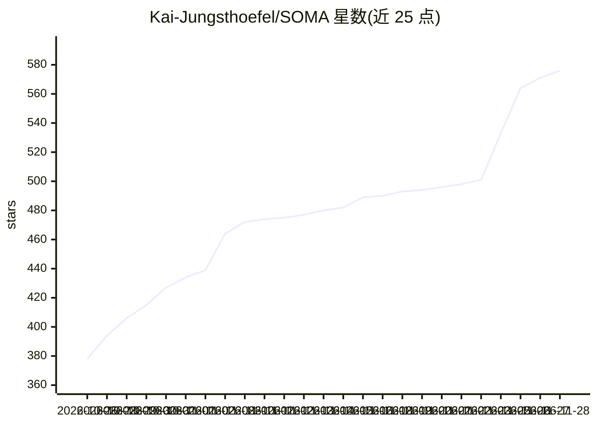

# Kai-Jungsthoefel/SOMA

⭐ 576 · TypeScript · GPL-3.0 · 推送 2026-11-27 · [GitHub](https://github.com/Kai-Jungsthoefel/SOMA) · [官网](https://somacad.app/) · 个人维护

**面向创客的桌面 CAD 应用：与编码代理协作生成参数化 3D 模型**

一个 Electron 桌面应用，将 AI 编码代理与 CadQuery 参数化建模结合：用户用自然语言、语音或草图描述零件，代理生成 Python 代码，SOMA 实时重建并显示 3D 结果，用户通过点击、测量、在视图上标注进行反馈迭代。内置 SOMA AI 代理（需 ChatGPT/Copilot 订阅或 API key），也可接入 Claude Code、Codex CLI 等外部 CLI 代理，通过 `soma build/analyze/render` 命令行工具和 AGENTS.md 规则协作。提供 FEM 分析、爆炸图、动画、技术图纸、STEP 导入与 STL/3MF/DXF 导出。提供 Windows/Linux/macOS 安装包，需约 1GB 磁盘空间，Linux 需 glibc 2.31+。

## 筛选速览

| 维度 | 判定 | 备注 |
|---|---|---|
| AI 角色 | `ai-native` | 本体是模型或模型工具 |
| 许可风险 | `viral` | GPL-3.0 |
| 部署形态 | `desktop` | 安装包/桌面程序 |
| 模型依赖 | — | README 未给出锁定关系 |
| 硬件要求 | — | 无带数字的原话,不猜 |
| 安装摩擦 | `low` | 无编译、无系统依赖或容器化 |
| 成熟度 | — | 结构信号不足 |

## 能力要点

- 代理生成 CadQuery Python 代码，模型随每次修改实时重建
- 内置 SOMA AI 聊天代理，支持语音输入与草图照片描述
- 可接入 Claude Code、Codex CLI、Gemini CLI 等外部代理，或 Codex app/Claude Desktop 等桌面代理应用
- FEM 强度分析（CalculiX）、悬垂/壁厚检测、技术图纸与多格式导出

## 适用场景

- 为 3D 打印项目快速生成外壳、支架、固定件等零件
- 用语音或草图描述想法，迭代获得可打印的参数化模型
- 在已有 CadQuery 脚本或 Git 文件夹基础上继续代理建模
- 为打印做悬垂与壁厚检查、FEM 强度分析

## 场景标签

`编码 Agent` `代码生成` · 领域:编码与开发

## 证据(README 行号)

> L9: You tell the agent what you need. It writes the model as Python code with CadQuery, SOMA builds it and shows the res
> L13: A CAD program where the AI does the CAD and you are the designer. SOMA brings together the three parts this needs: 
> L17: SOMA brings its own agent, SOMA AI: a chat next to the model, no coding agent needed. Describe the part in your own

## 星数曲线

2026-10-26 378 → 2026-11-28 576（+198）

---
*卡片 v1 · prompt 1.4 · 生成 2026-11-28 · 置信度 mid · 依据 README sha `f0372a54d092` · [字段定义](../../DATASET.md)*
