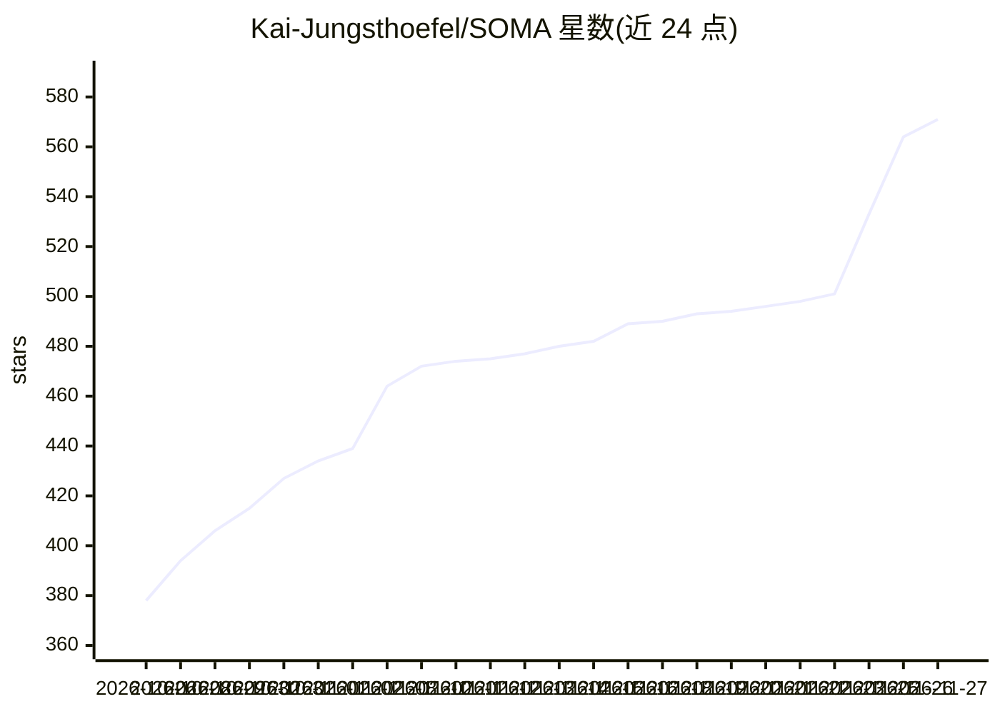

# Kai-Jungsthoefel/SOMA

⭐ 571 · TypeScript · GPL-3.0 · 推送 2026-11-22 · [GitHub](https://github.com/Kai-Jungsthoefel/SOMA) · [官网](https://somacad.app/) · 个人维护

**与 AI 编码代理协作设计参数化 3D 模型的桌面 CAD 应用**

面向 makers/tinkerers 的桌面应用：用户描述需求，代理用 CadQuery 编写 Python 模型代码，SOMA 实时构建并在 3D 视图中展示，用户通过点击、测量、在视图上绘制反馈，代理迭代修改。内置 SOMA AI（聊天/语音/草图输入），也支持接入 Claude Code、OpenCode、Codex CLI、Gemini CLI 等外部 CLI 代理，通过 soma build/analyze/render 等命令行工具与 AGENTS.md 规则协作。支持 FEM 分析（CalculiX）、参数调节、历史时间线、标准件库，导出 STEP/STL/3MF/DXF/PDF。安装包内含 Python、CadQuery、Git、CalculiX，占用超 1 GB。

## 筛选速览

| 维度 | 判定 | 备注 |
|---|---|---|
| AI 角色 | `ai-native` | 本体是模型或模型工具 |
| 许可风险 | `viral` | GPL-3.0 |
| 部署形态 | `desktop` | 安装包/桌面程序 |
| 模型依赖 | — | README 未给出锁定关系 |
| 硬件要求 | — | 无带数字的原话,不猜 |
| 安装摩擦 | `low` | 无编译、无系统依赖或容器化 |
| 成熟度 | — | 结构信号不足 |

## 能力要点

- 内置 SOMA AI 代理聊天，支持语音与草图照片输入
- 支持 Claude Code/OpenCode/Codex CLI/Gemini CLI 等外部代理接入
- 模型以 CadQuery Python 代码呈现，每次修改自动重建
- FEM 分析、悬垂/壁厚检查、动画与工程图导出

## 适用场景

- 为 Raspberry Pi 等项目生成可 3D 打印的外壳与支架
- 不懂 CadQuery 但需要参数化零件的创客
- 对已有 CadQuery 脚本用代理迭代改进并导出 STEP/STL

## 场景标签

`编码 Agent` · 领域:编码与开发

## 证据(README 行号)

> L9: You tell the agent what you need. It writes the model as Python code with CadQuery, SOMA builds it and shows the res
> L13: A CAD program where the AI does the CAD and you are the designer. SOMA brings together the three parts this needs: 
> L17: SOMA brings its own agent, SOMA AI: a chat next to the model, no coding agent needed. Describe the part in your own

## 星数曲线

2026-10-26 378 → 2026-11-27 571（+193）

---
*卡片 v1 · prompt 1.4 · 生成 2026-11-25 · 置信度 high · 依据 README sha `1b6638ff1755` · [字段定义](../../DATASET.md)*
