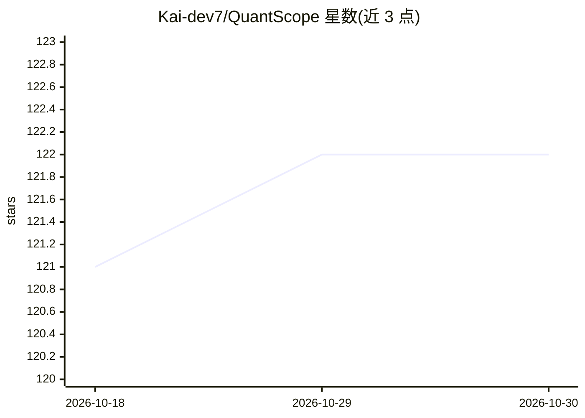

# Kai-dev7/QuantScope

⭐ 122 · Python · NOASSERTION · 推送 2026-07-09 · [GitHub](https://github.com/Kai-dev7/QuantScope) · [官网](http://150.158.144.155:3000) · 个人维护 · 中文 README

**面向中文用户的 AI 股票研究分析平台**

AI 股票研究与分析平台，覆盖数据同步、研究流程编排、多模型接入与报告导出。分析任务由多个 AI 角色协作完成：四类分析师并行采集、多空辩论、交易决策与三重视角风险评估，最终输出 Markdown/Word/PDF 报告。支持 A 股、港股、美股，接入 Tushare/AkShare/BaoStock 数据源与 OpenAI/DeepSeek/通义千问等模型。技术栈为 React 18 前端 + FastAPI/MongoDB/Redis 后端，提供 Docker Compose 部署、定时分析计划与 MCP 接口。项目声明仅用于研究与策略实验，不构成投资建议。

## 筛选速览

| 维度 | 判定 | 备注 |
|---|---|---|
| AI 角色 | `ai-native` | 本体是模型或模型工具 |
| 许可风险 | `none` | NOASSERTION |
| 部署形态 | `self-host` | docker 或自建部署 |
| 模型依赖 | locked-api |  |
| 硬件要求 | — | 无带数字的原话,不猜 |
| 安装摩擦 | `low` | 无编译、无系统依赖或容器化 |
| 成熟度 | — | 结构信号不足 |

## 能力要点

- 多 AI 角色协作流程：并行采集→多空辩论→交易决策→三重视角风险评估
- 支持 A 股/港股/美股，接入 Tushare、AkShare、BaoStock 数据源
- Markdown/Word/PDF 报告导出与邮件推送
- 暴露 MCP server（submit_single_analysis、get_final_report）

## 适用场景

- 用自然语言提交单股分析并查看多阶段研究报告
- 定时（每日/每周/每月）自动执行股票分析并接收邮件报告
- 作为内部研究平台原型或面向中文用户的二次开发基础
- 多模型、多数据源的分析效果对比实验

## 场景标签

`金融量化` · 领域:学习与行业

## 证据(README 行号)

> L8: 面向中文用户的 AI 股票研究与分析平台，提供从数据同步、研究流程编排、多模型接入到报告导出的完整工作流。项目定位为学习、研究与策略实验，不提供实盘交易指令，也不构成投资建议。
> L22: - **单股分析**：自然语言描述股票（如"帮我分析贵州茅台"），自动提取股票代码，提交深度分析任务
> L23: - 多角色协作研究流程：市场、基本面、新闻、社交媒体分析师并行采集，辩论阶段多空双方交锋，风控阶段三重视角评估，最终由交易员和风险经理输出决策

## 星数曲线

2026-10-18 121 → 2026-10-30 122（+1）

---
*卡片 v1 · prompt 1.4 · 生成 2026-10-23 · 置信度 high · 依据 README sha `d1e0a414e75a` · [字段定义](../../DATASET.md)*
