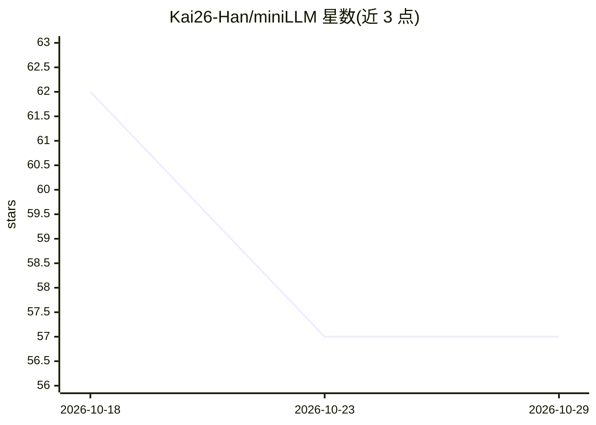

# Kai26-Han/miniLLM

⭐ 57 · Python · 推送 2026-09-23 · [GitHub](https://github.com/Kai26-Han/miniLLM) · [官网](https://www.modelscope.cn/studios/kayson2026/miniLLM) · 个人维护 · 中文 README

**单卡从零训练 200M 参数语言模型的教学实验项目**

面向学习与动手实验的语言模型项目：从原始语料与 ByteLevel-BPE 分词器开始，覆盖预训练、全参数 SFT、LoRA、黑盒蒸馏、DPO/PPO/GRPO、Agentic RL 与 VLM 视觉扩展等完整生命周期。模型为 decoder-only Transformer（RMSNorm、RoPE、GQA、SwiGLU），默认 4 专家 Top-1 的稀疏 MoE，总参约 199.8M、激活约 65.3M。在单张 RTX 4090 上训练，配套中英双语理论文章与实践指南，各阶段可读、可复现、可比较、可扩展。

## 筛选速览

| 维度 | 判定 | 备注 |
|---|---|---|
| AI 角色 | `ai-native` | 本体是模型或模型工具 |
| 许可风险 | `none` | — |
| 部署形态 | `None` |  |
| 模型依赖 | — | README 未给出锁定关系 |
| 硬件要求 | — | 无带数字的原话,不猜 |
| 安装摩擦 | `low` | 无编译、无系统依赖或容器化 |
| 成熟度 | — | 结构信号不足 |

## 能力要点

- 从零训练的 8,192-token ByteLevel-BPE 分词器与 chat 模板
- decoder-only Transformer：RMSNorm/RoPE/GQA/SwiGLU，默认稀疏 MoE（4 专家 Top-1）
- 覆盖预训练、SFT、LoRA、蒸馏、DPO/PPO/GRPO、Agentic RL 与 VLM 扩展
- 单张 RTX 4090 即可完成训练，配套中英双语学习材料

## 适用场景

- 在单卡上从零走一遍 LLM 训练全流程以理解原理
- 学习 tokenizer、MoE、偏好对齐与强化学习等机制并动手实验
- 对比 Dense 与 MoE、PPO 与 GRPO 等受控实验

## 场景标签

`模型训练` `微调` `强化学习` `教程课程` · 领域:学习与行业

## 证据(README 行号)

> L13: miniLLM is a language-model project for learning, research, and hands-on experimentation.
> L15: The project aims to turn language models from black boxes that can merely be called into engineering systems that c

## 星数曲线

2026-10-18 62 → 2026-10-29 57（-5）

---
*卡片 v1 · prompt 1.4 · 生成 2026-10-24 · 置信度 high · 依据 README sha `9f2af9fc144a` · [字段定义](../../DATASET.md)*
