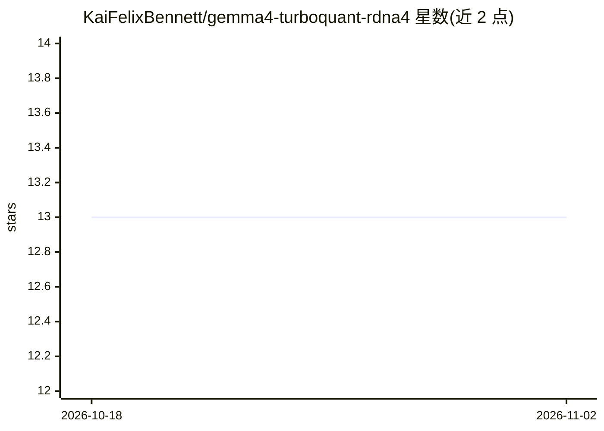

# KaiFelixBennett/gemma4-turboquant-rdna4

⭐ 13 · Python · MIT · 推送 2026-10-05 · [GitHub](https://github.com/KaiFelixBennett/gemma4-turboquant-rdna4) · 个人维护

**在 32GB AMD RDNA4 GPU 上跑满 Gemma-4-31B 256K 上下文的补丁与实测报告**

面向 AMD RDNA4（gfx1201）用户的 llama.cpp 长上下文部署方案：提供 HIP-graph-safe Flash-Attention 补丁，使 TurboQuant 3/4-bit 量化 KV cache 与 HIP graphs 共存，在 Radeon AI PRO R9700（32GB）上以 22.88GB VRAM 加载 Gemma-4-31B-it 完整 256K 上下文，实测 735 tok/s prefill。附带两类配置陷阱结论（超大 batch 缓冲、llama-server session-state 默认值）与 KL 散度、needle-in-haystack 质量验证，提供一键构建脚本和 VS Code Copilot 本地模型接入文档。限制：HIP 补丁仅适用于 AMD HIP，RDNA3 未测试。

## 筛选速览

| 维度 | 判定 | 备注 |
|---|---|---|
| AI 角色 | `ai-ecosystem` | LLM/agent 周边工具 |
| 许可风险 | `permissive` | MIT |
| 部署形态 | `None` |  |
| 模型依赖 | local-ok | 支持本地模型 |
| 硬件要求 | — | 无带数字的原话,不猜 |
| 安装摩擦 | `high` | 编译与系统依赖俱全 |
| 成熟度 | — | 结构信号不足 |

## 能力要点

- HIP-graph-safe Flash-Attention 补丁使 TurboQuant KV 与 HIP graphs 共存（已提交上游 PR #176）
- 32GB 卡实测加载完整 256K 上下文（22.88GB VRAM，余 ~9GB）
- 识别两个配置陷阱：-b 16384 batch 缓冲与 llama-server session-state 默认值，各损 5-10× / 2.6× decode
- KL 散度与 needle-in-a-haystack（8K–33K，9/9）双重质量验证

## 适用场景

- 在 AMD RDNA4 显卡上本地运行 Gemma-4-31B 的长上下文推理
- 长上下文 agent 编码会话（如接入 VS Code Copilot Chat 作本地模型）
- 排查 llama.cpp 长上下文下 decode 速度骤降的配置问题

## 场景标签

`推理引擎` `模型量化` · 领域:训练与推理

## 证据(README 行号)

> L33: 1. **A fix (new).** A small HIP-graph-safe Flash-Attention patch makes TurboQuant's quantized
> L91: TheTom's `llama-cpp-turboquant` fork adds
> L206: llama-server \

## 星数曲线

2026-10-18 13 → 2026-11-02 13（+0）

---
*卡片 v1 · prompt 1.4 · 生成 2026-10-31 · 置信度 high · 依据 README sha `23e21334894b` · [字段定义](../../DATASET.md)*
