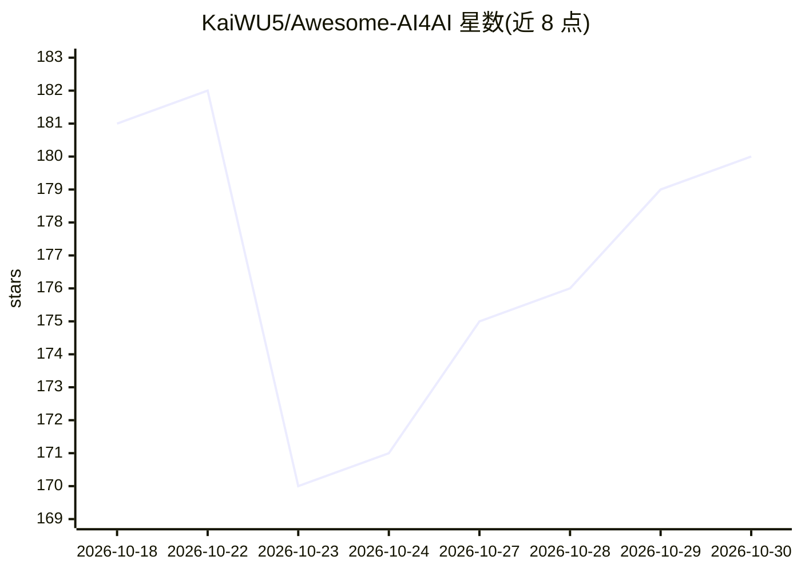

# KaiWU5/Awesome-AI4AI

⭐ 180 · Python · MIT · 推送 2026-10-26 · [GitHub](https://github.com/KaiWU5/Awesome-AI4AI) · [官网](https://kaiwu5.github.io/Awesome-AI4AI/) · 个人维护

**AI4AI 论文周更策展清单：AI 改进 AI 的研究地图与排名**

围绕“AI 改进 AI（AI4AI）”主题的 awesome 类策展仓库，配套一篇 223 篇论文的 AI4AI Survey（23 位作者、7 家机构）。每周一更新：按发布者权威度、讨论量、可验证结果等标准挑选 Top 10 新闻；引用数据取自 Semantic Scholar 与 OpenAlex，GitHub 星数为快照，提供按月均引用与分年度的论文排名，主题覆盖长程 agent、benchmark、harness 设计与递归自我改进。声明排名仅为发现辅助、非质量评分。面向 AI 研究者与 agent 开发者，无安装运行流程，仅浏览阅读。

## 筛选速览

| 维度 | 判定 | 备注 |
|---|---|---|
| AI 角色 | `ai-knowledge` | 知识聚合/清单类 |
| 许可风险 | `permissive` | MIT |
| 部署形态 | `None` |  |
| 模型依赖 | — | README 未给出锁定关系 |
| 硬件要求 | — | 无带数字的原话,不猜 |
| 安装摩擦 | `low` | 无编译、无系统依赖或容器化 |
| 成熟度 | — | 结构信号不足 |

## 能力要点

- 每周一更新的 Top 10 新闻挑选，仅引一手来源
- 月均引用与分年度引用排名（Semantic Scholar/OpenAlex 数据）
- 配套 AI4AI Survey 论文（223 篇、长程 agent 到递归自我改进）
- 提供项目站点、博客、DOI 与 RSIHub Harness 链接

## 适用场景

- 跟踪 AI 自我改进与长程 agent 领域的每周论文动态
- 按引用排名查找该领域高关注度论文与代码仓库
- 作为 agent benchmark 与 harness 研究的入门地图

## 场景标签

`精选清单` · 领域:学习与行业

## 证据(README 行号)

> L9:  AI4AI Survey: From Long-Horizon Agents to Recursive Self-Improvement
> L12:  Top AI-for-AI papers, releases, and blogs — curated every week. Stay tuned 🔥
> L27:  Top papers and releases, selected every week and verified against primary sources.

## 星数曲线

2026-10-18 181 → 2026-10-30 180（-1）

---
*卡片 v1 · prompt 1.4 · 生成 2026-10-22 · 置信度 high · 依据 README sha `8e6be7f3024e` · [字段定义](../../DATASET.md)*
