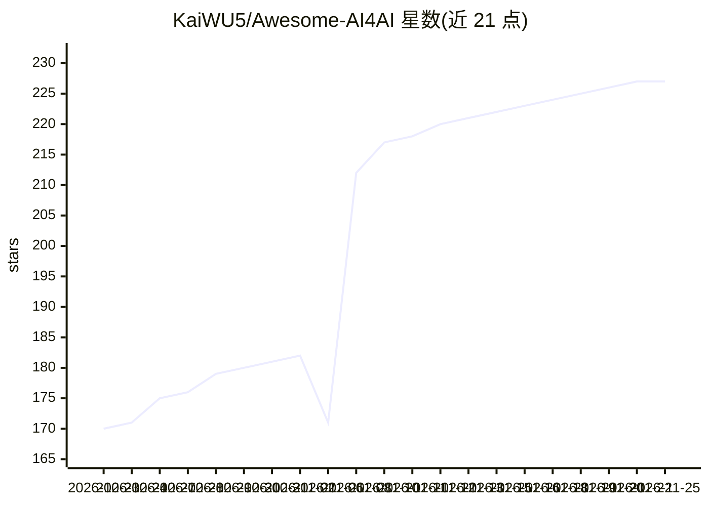

# KaiWU5/Awesome-AI4AI

⭐ 227 · Python · MIT · 推送 2026-11-23 · [GitHub](https://github.com/KaiWU5/Awesome-AI4AI) · [官网](https://kaiwu5.github.io/Awesome-AI4AI/) · 组织维护

**AI4AI 研究论文策展清单：1885 篇论文+排名+每周新闻**

围绕 AI 改进 AI（AI4AI）主题的论文目录，按 Benchmark、Harness Design、Model Design 组织，收录 1885 篇论文（836 基准、1217 harness 研究、437 模型研究），并附一份 223 篇论文的综述。每周更新：基于 Semantic Scholar 与 OpenAlex 的引用数、GitHub 星数的排名快照，以及注明来源的每周要闻。声明排名仅为发现辅助而非质量评分，并披露未能刷新的记录数。

## 筛选速览

| 维度 | 判定 | 备注 |
|---|---|---|
| AI 角色 | `ai-knowledge` | 知识聚合/清单类 |
| 许可风险 | `permissive` | MIT |
| 部署形态 | `None` |  |
| 模型依赖 | — | README 未给出锁定关系 |
| 硬件要求 | — | 无带数字的原话,不猜 |
| 安装摩擦 | `low` | 无编译、无系统依赖或容器化 |
| 成熟度 | — | 结构信号不足 |

## 能力要点

- 1885 篇论文按基准/harness/模型三类组织，附 223 篇综述
- 引用数与 GitHub 星数排名，标注快照日期与核验状态
- 每周要闻仅引用原始来源，性能声明归属发布方

## 适用场景

- 跟踪自动化 AI 研究与自我改进方向的论文进展
- 为综述或调研查找相关基准与 harness 研究文献
- 每周浏览该领域的要闻与高被引论文

## 场景标签

`精选清单` `科研工具` · 领域:学习与行业

## 证据(README 行号)

> L3:  🚀 Awesome AI4AI
> L14:  Living catalog: 1885 papers · 836 benchmarks · 1217 harness studies · 437 model studies Collections overlap. The o

## 星数曲线

2026-10-23 170 → 2026-11-25 227（+57）

---
*卡片 v1 · prompt 1.4 · 生成 2026-11-25 · 置信度 high · 依据 README sha `10d561bc7ad8` · [字段定义](../../DATASET.md)*
