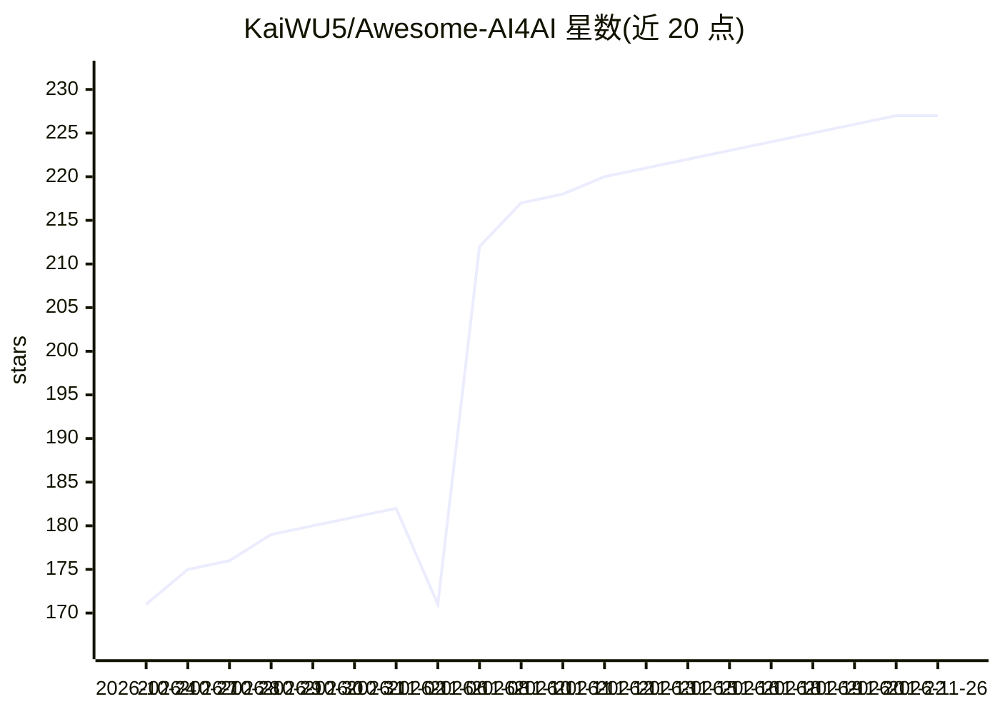

# KaiWU5/Awesome-AI4AI

⭐ 227 · Python · MIT · 推送 2026-11-24 · [GitHub](https://github.com/KaiWU5/Awesome-AI4AI) · [官网](https://kaiwu5.github.io/Awesome-AI4AI/) · 组织维护

**AI 自动改进 AI 方向的论文清单：每周更新 2000 篇策展论文**

AI4AI（AI 改进 AI）方向的策展论文目录：收录 2000 篇论文，覆盖 874 个基准、1254 项 harness 研究与 510 项模型研究，按长程 agent 到递归自我提升的主题组织。附基于 Semantic Scholar 与 OpenAlex 的月均引用排名、GitHub stars 数据及每周新闻精选，每周更新并注明来源核实状态。项目同时关联一篇 23 位作者的综述论文、项目站点与 RSIHub harness。

## 筛选速览

| 维度 | 判定 | 备注 |
|---|---|---|
| AI 角色 | `ai-knowledge` | 知识聚合/清单类 |
| 许可风险 | `permissive` | MIT |
| 部署形态 | `None` |  |
| 模型依赖 | — | README 未给出锁定关系 |
| 硬件要求 | — | 无带数字的原话,不猜 |
| 安装摩擦 | `low` | 无编译、无系统依赖或容器化 |
| 成熟度 | — | 结构信号不足 |

## 能力要点

- 2000 篇论文的活目录，含基准/harness/模型三类研究
- 基于 Semantic Scholar 与 OpenAlex 的引用与 stars 排名，定期刷新并披露核实进度
- 每周新闻精选：30 天内十大进展，仅引用一手来源
- 关联 23 作者、7 机构的 AI4AI 综述与项目站点

## 适用场景

- 跟踪 AI 自动化研究与自我提升方向的最新论文
- 为综述或调研查找 agent 基准与 harness 研究文献
- 按引用与 stars 排名发现该领域高关注度工作

## 场景标签

`精选清单` `科研工具` · 领域:学习与行业

## 证据(README 行号)

> L14:  Living catalog: 2000 papers · 874 benchmarks · 1254 harness studies · 510 model studies Collections overlap. The o
> L29:  New papers added to the catalog, plus source-verified papers and releases selected every week.

## 星数曲线

2026-10-24 171 → 2026-11-26 227（+56）

---
*卡片 v1 · prompt 1.4 · 生成 2026-11-26 · 置信度 high · 依据 README sha `0e89f911121b` · [字段定义](../../DATASET.md)*
