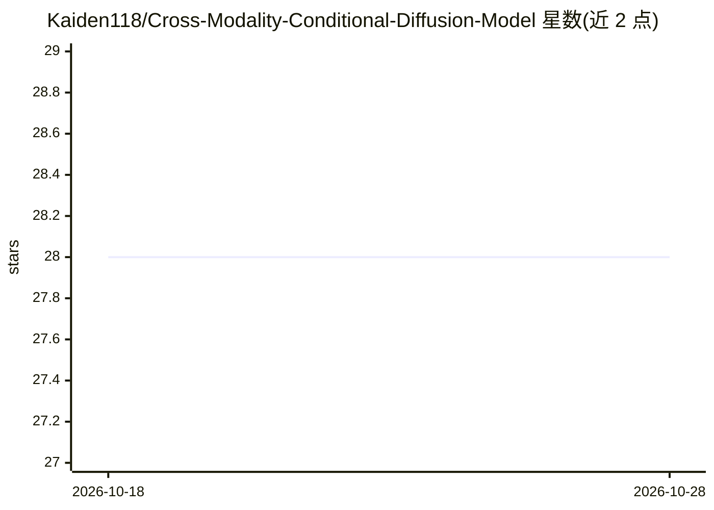

# Kaiden118/Cross-Modality-Conditional-Diffusion-Model

⭐ 28 · Python · MIT · 推送 2026-05-13 · [GitHub](https://github.com/Kaiden118/Cross-Modality-Conditional-Diffusion-Model) · 个人维护

**面向科研者的 T1/T2 MRI 跨模态图像翻译扩散模型实现**

基于 DDPM 的医学影像跨模态翻译框架：以 T1 加权像为条件生成对应 T2 加权 MRI 图像，或反向。核心机制包括解剖结构一致性引导（ASCG）、Unet 交叉注意力条件编码、分类器自由引导（CFG）与 MSE+L1+SSIM 复合损失，针对单通道灰度医学图像优化。训练数据为 BraTS2019/2020，需自行下载并转换为 PNG。以 Python 源码形式提供，通过 pip 安装依赖后运行 train.py/test.py。交叉注意力训练需高 GPU 开销，README 建议默认关闭。

## 筛选速览

| 维度 | 判定 | 备注 |
|---|---|---|
| AI 角色 | `ai-native` | 本体是模型或模型工具 |
| 许可风险 | `permissive` | MIT |
| 部署形态 | `library` | 以包/库形式分发 |
| 模型依赖 | — | README 未给出锁定关系 |
| 硬件要求 | — | 无带数字的原话,不猜 |
| 安装摩擦 | `low` | 无编译、无系统依赖或容器化 |
| 成熟度 | — | 结构信号不足 |

## 能力要点

- ASCG 解剖结构一致性引导，约束去噪过程中的结构漂移
- 交叉注意力条件机制与分类器自由引导（CFG）
- MSE+L1(0.3)+SSIM(0.2) 多准则复合损失
- 单通道医学图像输入/输出优化，默认 channels=1

## 适用场景

- 在 BraTS 数据上训练 T1→T2 MRI 翻译模型
- 医学影像合成研究中的条件扩散模型基线
- 生成缺失模态的 MRI 图像用于下游研究

## 场景标签

`图像生成` `科研工具` · 领域:内容生成

## 证据(README 行号)

> L3: This project implements a cross-modality medical image translation framework based on the Denoising Diffusion Probab
> L9: * **Anatomy-Consistent Structural Guidance (ASCG)**: The core technical innovation of the CMCD framework, designed t

## 星数曲线

2026-10-18 28 → 2026-10-28 28（+0）

---
*卡片 v1 · prompt 1.4 · 生成 2026-10-26 · 置信度 mid · 依据 README sha `a1bfe3c590ba` · [字段定义](../../DATASET.md)*
