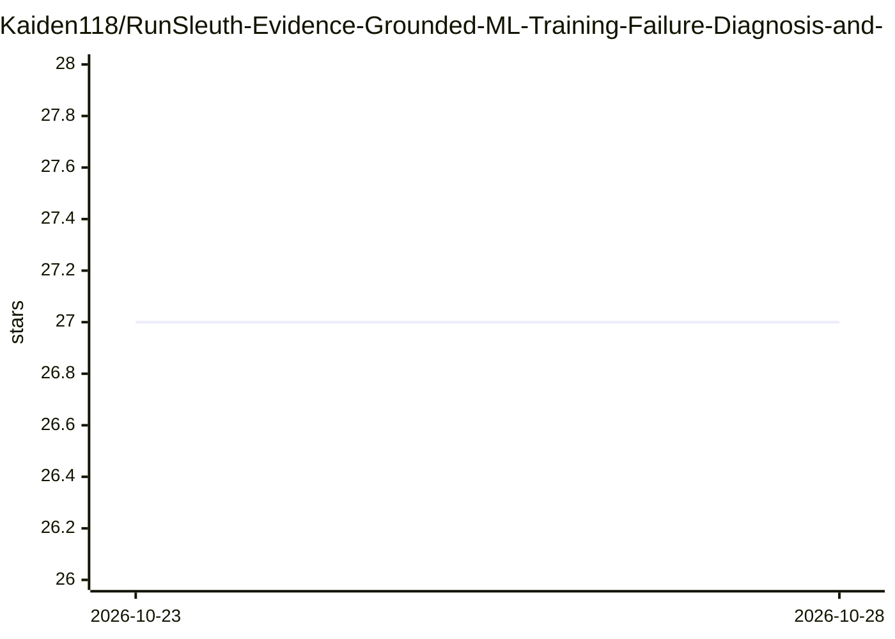

# Kaiden118/RunSleuth-Evidence-Grounded-ML-Training-Failure-Diagnosis-and-Repair-Verification

⭐ 27 · Python · MIT · 推送 2026-10-27 · [GitHub](https://github.com/Kaiden118/RunSleuth-Evidence-Grounded-ML-Training-Failure-Diagnosis-and-Repair-Verification) · 个人维护

**核查 LLM agent 对 PyTorch 训练代码修复的诊断与验证工具**

面向 PyTorch 训练故障的诊断与修复验证工具：通过训练运行中的证据（梯度、参数更新、归一化匹配等）识别冻结分类头、缺失 optimizer.step 等 10 类静默故障；对 agent 声称的修复，仅在运行证据支持时接受，否则拒绝或送审。含 22 任务/5 条件的 agent 研究与进行中的 6 任务修复验证（180 份测试修复、5 个 LLM agent 候选、跨厂商 LLM 审查者）。诊断可在 CPU 运行，训练验证需 8GB NVIDIA GPU，提供 Docker。

## 筛选速览

| 维度 | 判定 | 备注 |
|---|---|---|
| AI 角色 | `ai-ecosystem` | LLM/agent 周边工具 |
| 许可风险 | `permissive` | MIT |
| 部署形态 | `self-host` | docker 或自建部署 |
| 模型依赖 | local-ok | 支持本地模型 |
| 硬件要求 | `cpu-ok` | |
| 安装摩擦 | `low` | 无编译、无系统依赖或容器化 |
| 成熟度 | `idea` | |

## 能力要点

- 基于运行证据诊断 10 类静默训练故障，部分需健康参考运行
- 对 agent 修复做证据核查，仅证据支持时接受，否则拒绝或送审
- 可选 LLM 解释（Gemini 或 Ollama），须引用证据且不能改变诊断
- Agent 研究：22 任务 × 5 条件 × 2 模型，共 550 episodes/模型

## 适用场景

- 验证 LLM agent 修改后的训练脚本是否真正修复了故障
- 诊断不报错但准确率异常的静默训练故障
- 研究 LLM 证据对 agent 修复能力的影响

## 场景标签

`模型评测` · 领域:评测与运维

## 证据(README 行号)

> L9: RunSleuth checks the repairs LLM agents make to medical-imaging training code. A
> L67: (`GEMINI_API_KEY` and `GEMINI_MODEL`, or `--provider ollama`) must cite the evidence
> L120: |Verifiers|A calibrated metric gate; LLM reviewers Gemini 4 Argon and Claude Sonnet 5.5, from other vendors than t

## 星数曲线

2026-10-23 27 → 2026-10-28 27（+0）

---
*卡片 v1 · prompt 1.4 · 生成 2026-10-26 · 置信度 high · 依据 README sha `b1442f8ba6f2` · [字段定义](../../DATASET.md)*
